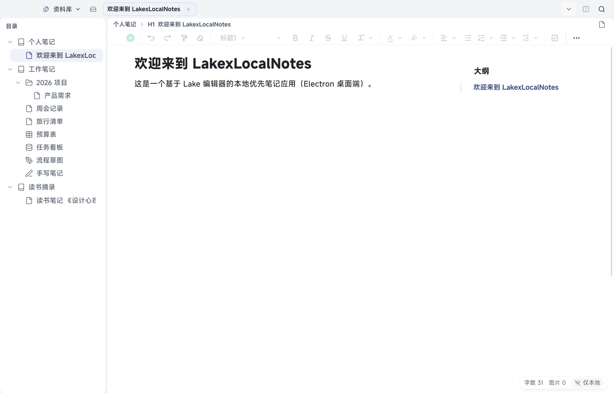
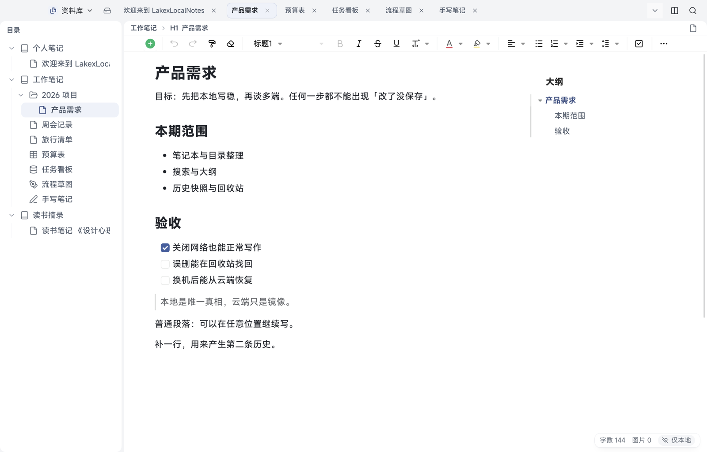
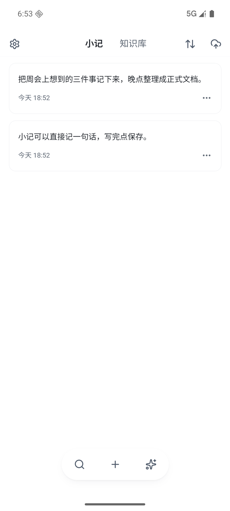
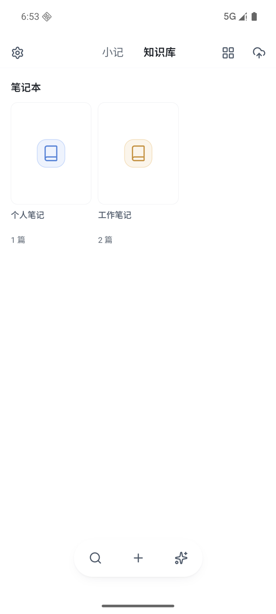
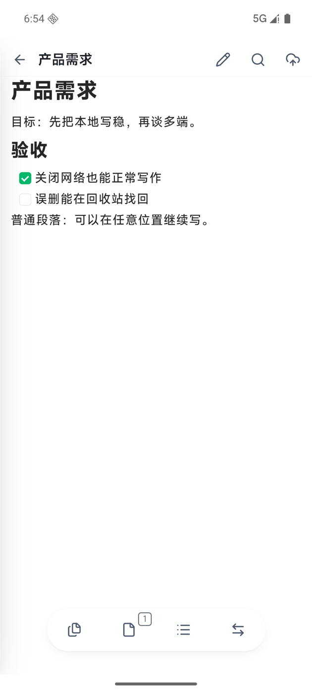
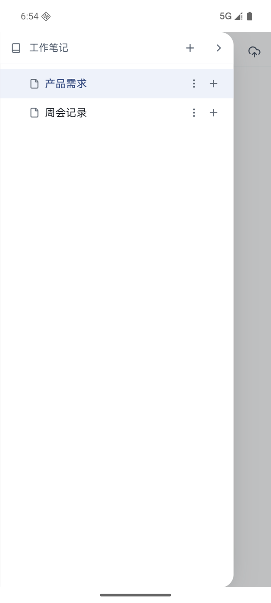
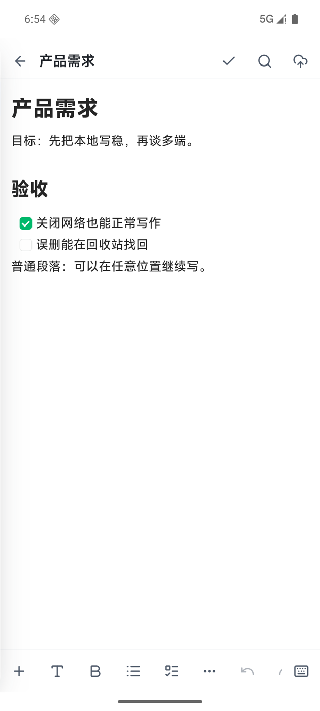
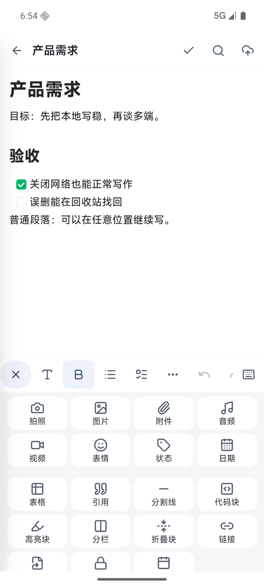

# 01 开始使用与界面总览

[← 返回目录](README.md) | 下一章：[02 笔记本与目录 →](02-notebooks.md)

## 桌面端界面

打开应用后，你会看到四个区域：

| 区域 | 位置 | 作用 |
| --- | --- | --- |
| 顶部横条 | 最上面 | 切「资料库 / 小记」、看同步状态、分屏、全局搜索、标签页 |
| 目录栏 | 左侧 | 笔记本、分组、文档的树形目录，可拖拽排序 |
| 编辑区 | 中间 | 打开文档后的正文与工具栏，标签页可开多篇 |
| 右栏大纲 | 右侧 | 当前文档的标题结构，点击可跳转；可切「增强大纲」（可筛选、折叠、显示级别） |
| 状态栏 | 右下角 | 字数、图片数、当前同步状态 |

### 顶部横条

- **资料库下拉**（`⌘1`）：在「资料库」和「小记」（`⌘2`）、「回收站」、「资源」、「偏好设置」之间切换
- **同步状态**：显示「仅本地」「已同步」「同步中」等。点击可看同步详情，手动同步也在这里
- **分屏**、**全局搜索**：分屏同时看两篇；搜索见 [08](08-search-outline-tags.md)
- **标签页**：每篇文档一个标签，可关闭、可拖动排序；「⋯」里能切换已打开的标签

### 目录栏

- 顶部一排小按钮：刷新目录、筛选目录、全部收起、定位到当前文档、新建
- 每一行右侧有两个按钮：「⋯」（更多操作）和「＋」（新建子项）
- 「⋯」菜单包含：新建、重命名、历史版本、属性、锁定（只读）、导出、删除
- 目录、文档都支持拖拽排序与移动层级

> 小技巧：目录不常用时按 `⌘]` 收起或固定，写作区会更宽。

### 编辑区

- 面包屑显示「笔记本 > 块类型 > 标题」，点面包屑可回到所属笔记本
- 固定工具栏从上到下依次是：插入「＋」、撤销/重做、清除格式、标题级别、加粗/斜体/删除线/下划线/行内代码、文字颜色、高亮、列表与对齐、待办、更多「⋯」
- 正文底部状态栏显示字数与图片数；这两项只统计当前文档

## Android 端界面

### 首页

 

| 区域 | 位置 | 作用 |
| --- | --- | --- |
| 顶部图标 | 顶栏左右 | 左：设置齿轮；中：小记 / 知识库 切换；右：排序、立即同步 |
| 内容区 | 中间 | 「小记」是时间线；「知识库」是笔记本书架 |
| 底部胶囊 | 屏幕底部 | 搜索、新建「＋」、AI 助手 |

- 在胶囊上**长按并上滑**可以直接进入速记（不用先回首页）
- 小记卡片右侧「⋯」可编辑、加标签、转正式文档、删除

### 工作区与目录抽屉

 

- 顶栏：返回、文档标题、编辑（铅笔）或完成（勾）、在文档中查找、立即同步
- 底部胶囊四格：**文档树、标签页、大纲、切换笔记本**
- 目录抽屉：每个笔记本一行（右侧「＋」）、每篇文档一行（「⋮」与「＋」）

### 编辑态

 

- 进入编辑后，底部出现工具条：「＋」插入、T 字体、B 加粗、列表、待办、「⋯」更多、撤销、重做、键盘开关
- 点「＋」展开插入面板（上图右）：拍照、图片、附件、音频、视频、表情、状态、日期、表格、引用、分割线、代码块、高亮块、分栏、折叠块、链接等
- 键盘与面板互斥：有面板时键盘收起，点键盘图标可换回输入

## 第一次使用会发生什么

1. 自动创建一个「个人笔记」笔记本和一篇欢迎文档
2. 没有登录、没有网络请求；状态栏显示「仅本地」
3. 数据写在本机数据库与文件里，关闭应用不会丢

## 想马上做的事

- 建一个自己的笔记本：[02 笔记本与目录](02-notebooks.md)
- 学会写第一篇：[03 文档编辑](03-editing.md)
- 随手记一句：[07 小记](07-quick-notes.md)
- 让手机和电脑数据一致：[11 云同步](11-cloud-sync.md)
