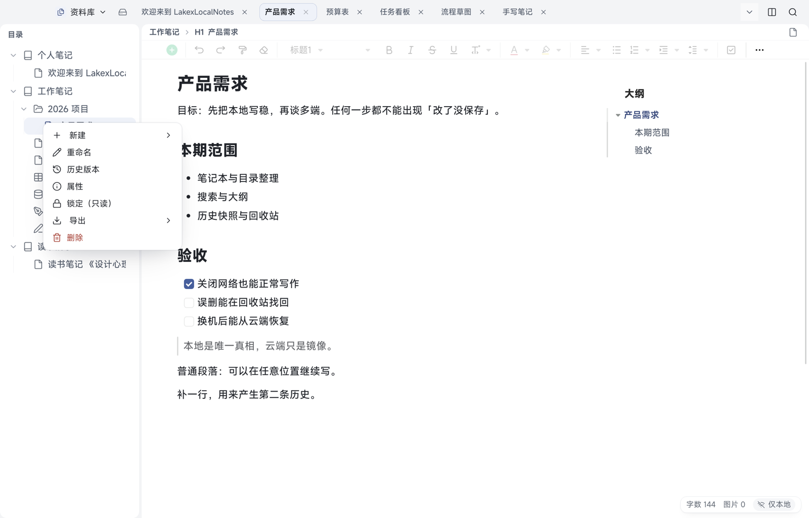

# 02 笔记本与目录

[← 返回目录](README.md) | 上一章：[01 开始使用](01-getting-started.md) | 下一章：[03 文档编辑 →](03-editing.md)

笔记本是文档的上一层容器。一个笔记本里可以放文档、表格、多维表、画板、手写板，也可以再建分组把文档分堆。


## 目录的结构

```text
笔记本
├── 分组（可选，可多层）
│   ├── 文档
│   └── 文档
├── 表格 / 多维表 / 画板 / 手写板
└── 文档
```

- 页面里看到的顺序就是目录顺序，可以直接拖拽调整
- 笔记本、分组、文档行都能拖到别的位置：拖到行中间是排序，拖到行上是移动进去

## 新建

桌面有两种方式：

1. 目录栏顶部「新建」按钮：选要建的东西（笔记本、分组、文档、表格、多维表、画板、手写板等）
2. 任意一行右侧「＋」：在该行下面新建子项

Android：首页「知识库」底部胶囊「＋」新建；目录抽屉里每个笔记本行右侧「＋」新建文档，抽屉工具栏也有「新建」。

## 重命名与图标

- 桌面：行右侧「⋯」→「重命名」；「⋯」里还有「设置图标」
- Android：目录抽屉行「⋮」→ 重命名 / 设置图标；笔记本卡片可**长按**打开编辑菜单

图标只是显示层面的装饰，不影响文档内容与同步。

## 移动与排序

- 拖动行到目标位置即可；拖动时目标行会高亮提示落点
- 误拖了可以再拖回去，不会丢内容
- 大量整理时，桌面比手机顺手

## 常用与打开

- 最近打开的文档会出现在标签页里，关掉标签不会删文档
- 目录顶部「定位到当前文档」可以快速找到正在编辑的文档在哪

## 删除与恢复

- 桌面：行右侧「⋯」→「删除」
- Android：行「⋮」→ 删除
- 删除的文档**先进入回收站**，不会立刻消失；默认 90 天后才自动彻底清理（见 [09](09-history-trash.md)）
- 删除一个分组或笔记本时，里面的内容会一起进入回收站，恢复时整棵恢复



文档行「⋯」菜单里的七项：新建、重命名、历史版本、属性、锁定（只读）、导出、删除。

> 想彻底删除：在回收站里选择该项再彻底删除。彻底删除后本机与云端都会删掉，不可撤销。

## 只读与属性

- 「锁定（只读）」把文档设为只读，避免误改；需要时再解除
- 「属性」显示文档的基本信息（所属笔记本、时间、大小等）
- 「导出」把当前文档导出成文件（格式按文档类型给可用项）

## Android 上的目录入口

- 工作区底部胶囊第一格「文档树」打开目录抽屉
- 抽屉里点击文档即可切换，切换不会关掉当前编辑内容（自动保存）
- 长文档用「大纲」抽屉跳转更省事（见 [08](08-search-outline-tags.md)）
