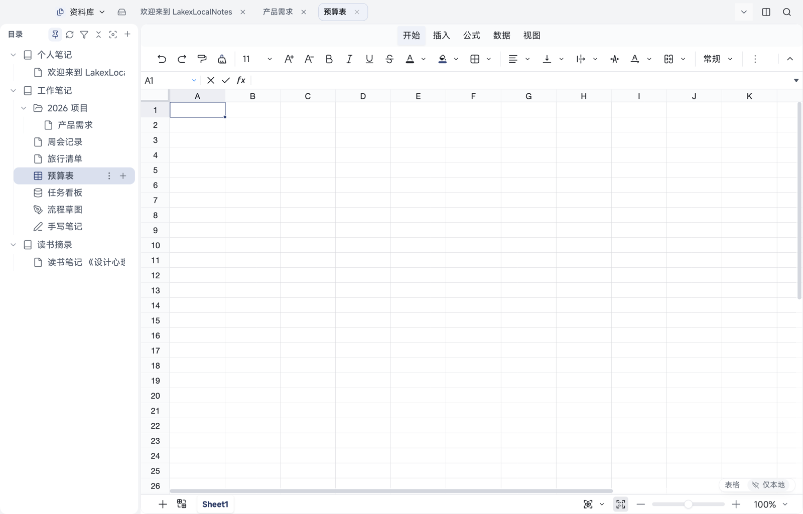

# 04 表格

[← 返回目录](README.md) | 上一章：[03 文档编辑](03-editing.md) | 下一章：[05 多维表 →](05-bitable.md)

表格是电子表格类文档，新建时选择「表格」，图标是网格样式。

## 界面分区

| 区域 | 位置 | 作用 |
| --- | --- | --- |
| 页签 | 顶部 | 开始、插入、公式、数据、视图，切换不同工具组 |
| 工具条 | 页签下方 | 撤销/重做、字号、加粗斜体下划线删除线、文字颜色、填充、边框、对齐、数字格式、合并等 |
| 名称框 | 左上方 | 显示或跳到单元格（如 A1），可输入区域快速定位 |
| 公式栏 | 名称框右侧 | 看/改当前单元格内容与公式，前面的 `fx` 是公式入口 |
| 行列头 | 表格区 | A、B、C 列与 1、2、3 行，点列头/行头选中整列/整行 |
| 工作表页签 | 底部 | 默认 `Sheet1`，左侧「＋」新建工作表 |
| 缩放 | 右下角 | 缩小/放大，显示当前百分比 |

## 输入与编辑

- 选中单元格直接输入，回车确认并下移，Tab 确认并右移
- 双击单元格进入编辑；编辑时公式栏同步显示内容
- 粘贴：从 Excel 或别处复制一块区域，选中左上角单元格粘贴即可展开
- 删除：选中后按 Delete 清空内容（格式保留），或用工具条的清除操作

## 常用格式

- 数字格式（「常规」下拉）：常规、数值、百分比、日期等
- 字号、加粗、斜体、下划线、删除线、文字颜色、填充色
- 对齐：水平与垂直对齐、自动换行
- 边框：选区边框与内部网格
- 合并单元格、插入/删除行列等操作也在「开始」页签的工具条里

## 公式

- 在单元格里以 `=` 开头输入，或用「公式」页签插入函数
- `fx` 公式栏可查看与编辑公式
- 常用的求和、平均、计数、条件判断都支持；跨单元格用 `A1`、`A1:B10` 这样的地址

## 冻结、筛选与排序

- 冻结：在「视图」页签里设置冻结，滚动时表头（或左侧列）保持可见
- 筛选：选中数据区域后开启筛选，按列条件过滤
- 排序：按选中列升序/降序，多列排序在排序面板里添加条件

## 查找替换

- 在「开始」页签的查找替换里输入内容，可逐项跳转替换
- 只影响当前工作表

## 多个工作表

- 底部「＋」新建工作表，双击页签可重命名
- 工作表之间用公式互引：`Sheet2!A1`
- 工作表是文档数据的一部分，会随之保存与同步；当前打开哪个工作表属于本机视图，不会写进文档

## Android 上的表格

- Android 打开表格为**查看+基础编辑**：顶部工具条（插入、撤销/重做、常规、⋯）、公式栏、底部工作表切换与缩放
- 阅读态工具条部分项目前为灰色占位，完整编辑请在桌面端进行
- 验收或截图时注意：部分表格内容绘制在 GPU 画布上，普通页面截图可能空白，请用系统截图

## 导出

- 桌面「⋯」或导出入口支持导出 CSV / XLSX（按当前工作表或整本）
- 导出文件会写到你在系统对话框里选择的目录
