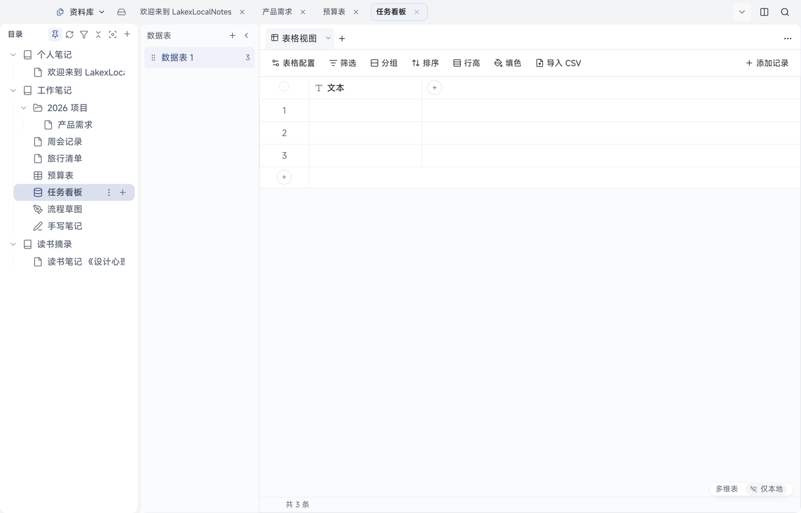

# 05 多维表

[← 返回目录](README.md) | 上一章：[04 表格](04-sheet.md) | 下一章：[06 画板与手写板 →](06-board-ink.md)

多维表不是普通表格，而是「有字段类型的数据库 + 视图」。同一份记录可以用表格视图看，也可以用看板视图看。

## 界面分区

| 区域 | 位置 | 作用 |
| --- | --- | --- |
| 数据表面板 | 左侧 | 一个多维表可以有多张数据表；「＋」新建 |
| 视图页签 | 上方 | 当前数据表的视图（如「表格视图」），右侧「＋」新建视图 |
| 工具栏 | 视图下方 | 表格配置、筛选、分组、排序、行高、填色、导入 CSV、添加记录 |
| 表格区 | 中间 | 行是记录，列是字段；行号显示记录序号 |
| 底部 | 左下 | 记录总数（如「共 3 条」） |

## 字段类型

新建数据表默认有一个「文本」字段。支持的字段类型包括：

- 文本、数字、单选、多选
- 日期、时间
- 布尔（勾选）
- 链接（网址）
- 评分、进度
- 关联（指向另一张表的记录）
- 附件、图片

字段可以在「表格配置」里改名、改类型、调整顺序、隐藏。

## 记录

- 点「＋ 添加记录」在末尾新增一行；点最后一行的「＋」也能加
- 单元格直接点开编辑，不同类型给不同的输入控件（日期选日历、单选下拉、布尔勾选框等）
- 记录可展开成详情面板，编辑长文本、附件与字段明细
- 重要数据建议定期「导出 CSV」备份一份

## 视图

- **表格视图**：全字段一览，适合录入与批量查看
- **看板视图**：按某个单选字段分组，卡片形式拖动改值，适合任务流
- 视图的筛选、排序、分组、字段显示/隐藏都是**视图配置**，属于文档数据，会同步到其他设备；当前打开哪张表/哪个视图属于本机视图，不写进文档

## 筛选、排序、分组

- 筛选：选择字段 + 条件（等于、包含、为空等）+ 值，可叠加多条
- 排序：可多字段、可设升降序
- 分组：按单选/文本等字段分组显示
- 填色：按条件给行或单元格上色

## 导入与导出

- 导入 CSV：把表格数据导成记录（首行作为字段名）
- 导出 CSV / ZIP：把当前数据表导出，便于备份或在别处打开

## Android 上的多维表

- Android 端多维表以**只读表格**展示：单元格按字段类型渲染（勾选框、星级、进度条、链接、关联标签等）
- 看板等非表格视图在移动端会提示「桌面已支持，移动端暂以表格只读展示」
- 需要编辑请用桌面端；改动会随同步出现在手机
