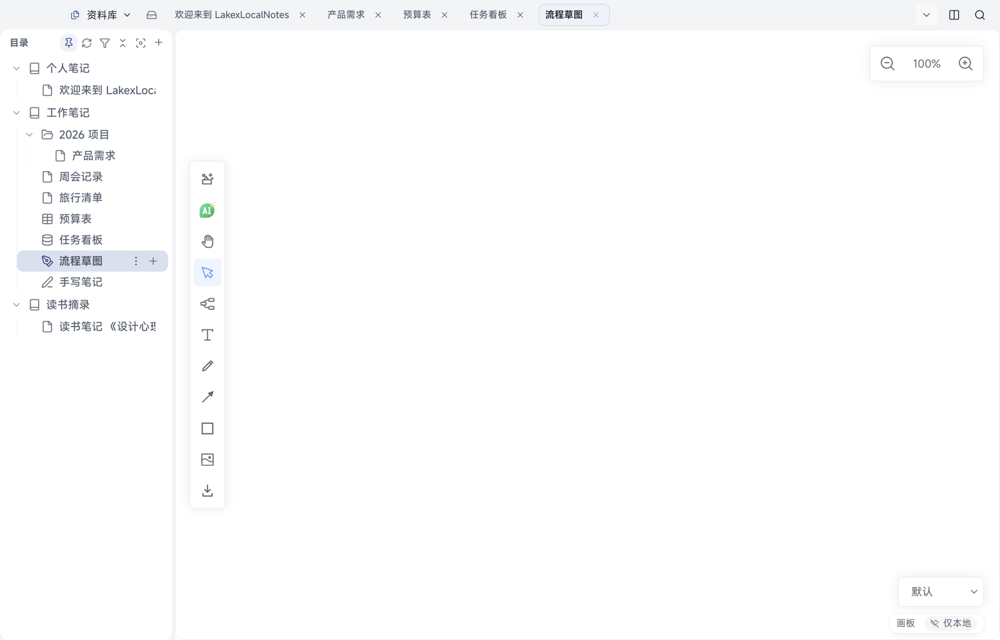
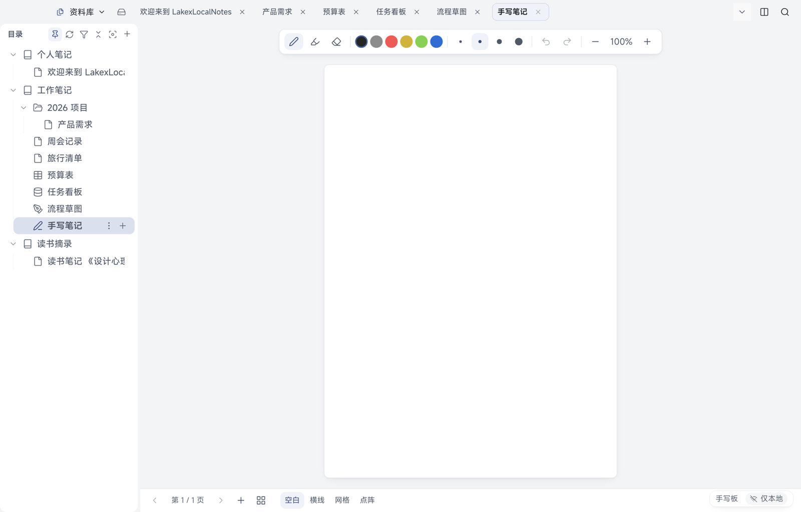

# 06 画板与手写板

[← 返回目录](README.md) | 上一章：[05 多维表](05-bitable.md) | 下一章：[07 小记 →](07-quick-notes.md)

画板适合画流程图、示意图；手写板适合写字、做手写笔记。两者都是独立类型的文档。

## 画板

| 区域 | 作用 |
| --- | --- |
| 左侧工具条 | 插入、AI 助手、抓手（平移）、选择、连线、文字、画笔、箭头、矩形等形状、图片、导出 |
| 右上角 | 缩放（点减号/加号或百分比） |
| 右下角 | 主题/风格下拉，切换画布外观 |
| 状态栏 | 显示「画板」与同步状态 |

用法要点：

- **选择**：切到选择工具后点元素或框选；选中可拖动、缩放、删除
- **连线**：选连线工具后从元素边缘拖到另一个元素
- **文字**：点画布输入文字，可在属性条里改字号与颜色
- **图片**：把图片拖进画布，或插入面板选图片
- **平移与缩放**：抓手工具拖动画面，右上角缩放
- 画板内容是一份文档数据，保存与同步方式与其他文档相同

> 画板上有一个 AI 入口（工具条上的 AI 徽标），可在画板上生成图形；AI 需要先在设置里配好（见 [10](10-ai.md)）。

## 手写板

| 区域 | 作用 |
| --- | --- |
| 顶部工具条 | 画笔、荧光笔、橡皮、颜色（黑/灰/红/黄/绿/蓝）、笔迹粗细、撤销、重做、缩放 |
| 中间 | 纸面，按页组织 |
| 底部 | 第 1/N 页、上一页/下一页、「＋」新建页、背景样式 |

- 背景样式：空白、横线、网格、点阵，可按页设置
- 多页：底部「＋」加页，页码处切换
- 手写板在 Android 上支持触屏书写；桌面用鼠标或数位笔
- 内容随文档保存与同步；当前页、缩放等视图状态只在本机

## 什么时候用哪个

| 需求 | 选择 |
| --- | --- |
| 画流程、框图、示意结构 | 画板 |
| 手写笔记、草稿、签名 | 手写板 |
| 文字为主、偶尔插图 | 普通文档（见 [03](03-editing.md)） |
| 大量数据与计算 | 表格（见 [04](04-sheet.md)） |
