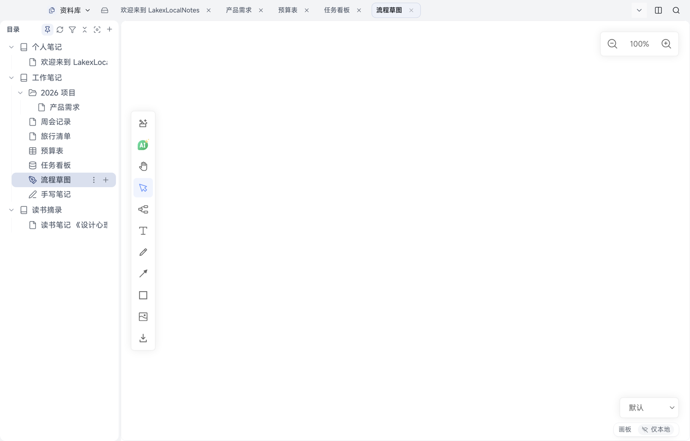
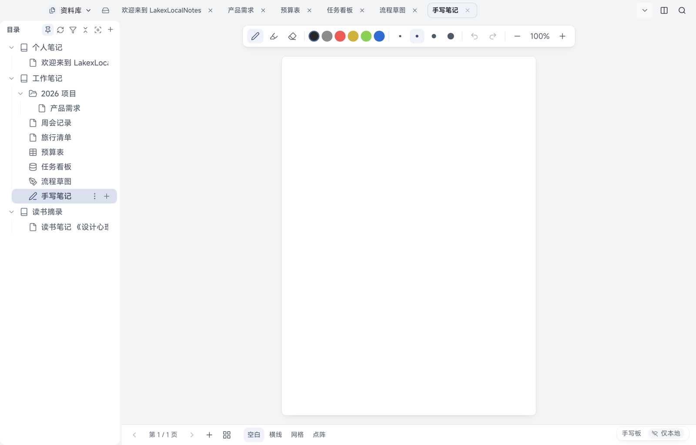

# 06 画板与手写板

[← 返回目录](README.md) | 上一章：[05 多维表](05-bitable.md) | 下一章：[07 小记 →](07-quick-notes.md)

画板适合画流程图、示意图；手写板适合写字、做手写笔记。两者都是独立类型的文档。

## 画板

| 区域 | 作用 |
| --- | --- |
| 左侧工具条 | 插入、AI 助手、抓手（平移）、选择、连线、文字、画笔、箭头、矩形等形状、图片、导出 |
| 右上角 | 缩放（点减号/加号或百分比） |
| 右下角 | 主题/风格下拉，切换画布外观 |
| 状态栏 | 显示「画板」与同步状态 |

用法要点：

- **选择**：切到选择工具后点元素或框选；选中可拖动、缩放、删除
- **连线**：选连线工具后从元素边缘拖到另一个元素
- **文字**：点画布输入文字，可在属性条里改字号与颜色
- **图片**：把图片拖进画布，或插入面板选图片
- **平移与缩放**：抓手工具拖动画面，右上角缩放
- 画板内容是一份文档数据，保存与同步方式与其他文档相同

> 画板上有一个 AI 入口（工具条上的 AI 徽标），可在画板上生成图形；AI 需要先在设置里配好（见 [10](10-ai.md)）。

## 手写板

| 区域 | 作用 |
| --- | --- |
| 顶部（桌面通栏工具条 / Android 悬浮条） | 桌面：画笔、荧光笔、橡皮、颜色、笔迹粗细、撤销重做、插入贴图/文字、缩放；Android：‹ n/N › 翻页、缩放、全局预览、页签（阅读态也能看） |
| 中间 | 纸面，按页组织（A4） |
| 底部（桌面底栏 / Android 编辑悬浮坞） | 桌面：第 N/M 页、新建页、页面（缩略图/大纲面板）、页签、导出、纸张样式、背景图片/背景 PDF；Android 编辑态：插入（文字/贴图）、画笔工具、纸张样式、背景图片/背景 PDF |

- 纸张样式：空白、横线、网格、点阵，可按页设置（仅纯矢量页；图片页以图片为纸面）
- **页面面板（桌面）**：底栏「页面」→ **左侧悬浮面板**，两个视图：**缩略图**（每页一格大图、点一下跳页、hover 删除、底部新建页）与 **大纲**（列表 + 筛选「全部 / 批注 / 页签」+ 查找页签文字或页码）；面板顶栏可**拖动右缘调宽**（记住宽度），跳页框在面板头部
- 多页：桌面底栏「＋」加页、缩略图里**长按拖动排序**；Android 在「全局预览」里新建/删除页（排序在桌面做）
- **图片页背景**：编辑态「背景图片」，每张图各成一页，可在图上直接手写批注
- **导入 PDF**：编辑态「背景 PDF」，按页栅格化为图片页后可批注；原 PDF 保留在文档资产里，上限 500 页
- **页签**：给某一页打标记；可以只打标记（不打字），也可以写一句说明（≤200 字）。桌面 = 底栏「页签」按钮；Android/Pad = 顶部悬浮条最右的书签图标。页签属于正文数据，会随文档同步；在大纲里可按页签筛选。
- **分享 PDF（Android）**：从文件管理器/微信等系统分享 PDF 到本应用，会自动新建手写板并导入每页
- **导出 PDF（桌面）**：文档右键/菜单 → 导出 → 导出为 PDF（手写压平），背景图与矢量笔迹合成 PDF
- 手写板在 Android 上支持触屏书写；桌面用鼠标或数位笔
- 内容随文档保存与同步；当前页、缩放、纸张等视图状态只在本机

## 什么时候用哪个

| 需求 | 选择 |
| --- | --- |
| 画流程、框图、示意结构 | 画板 |
| 手写笔记、草稿、签名 | 手写板 |
| 文字为主、偶尔插图 | 普通文档（见 [03](03-editing.md)） |
| 大量数据与计算 | 表格（见 [04](04-sheet.md)） |
