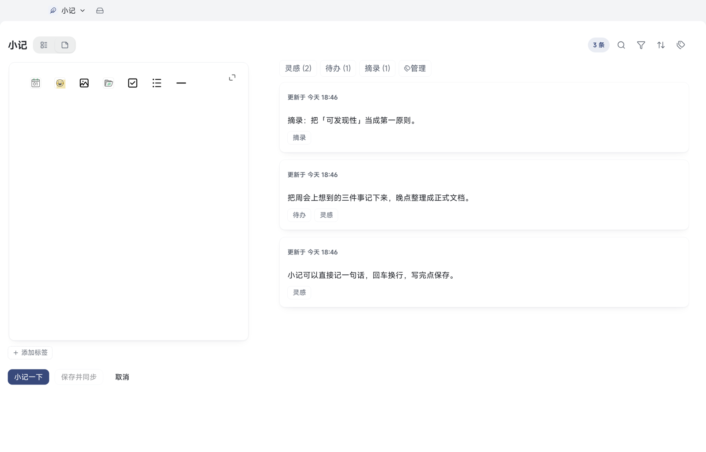

# 07 小记

[← 返回目录](README.md) | 上一章：[06 画板与手写板](06-board-ink.md) | 下一章：[08 搜索、大纲与标签 →](08-search-outline-tags.md)

小记是随手记的地方：不用先想放哪个笔记本，写完可以留在小记里，也可以转成正式文档。

## 打开小记

- 桌面：顶部「资料库」下拉 →「小记」（或按 `⌘2`）
- Android：首页「小记」tab；另外在底部胶囊上**长按上滑**可直接进入速记

## 写作卡

左侧卡片是写作区，顶部一排小工具：

| 工具 | 作用 |
| --- | --- |
| 日期 | 插入当前日期 |
| 表情 | 插入表情 |
| 图片 / 附件 | 插入图片或附件 |
| 待办 | 插入待办项 |
| 无序列表 | 插入列表 |
| 分隔线 | 插入分割线 |
| 展开 | 放大写作区 |

写完点「小记一下」保存到时间线，「取消」放弃这次编辑。

## 保存与保存并同步的区别

- **小记一下（保存）**：只把内容保存在本机，**不会立即上传**。适合随手记、不着急同步的时候。
- **保存并同步**：保存后立刻发起一次同步，这条小记马上进云端（需要已配好云同步并且在网络可用时）。
- 云同步没配置或关闭时，「保存并同步」按钮会置灰并给出原因；此时只保存本机。

> 从桌面图标长按进入的「小记」快捷入口属于「专心的写作」，这一次会话不会自动发起同步；只有你点「保存并同步」才会联网。

## 标签

- 时间线上方是标签栏，标签后面括号里的数字是该标签下小记条数
- 「添加标签」新建标签；点「管理」进入标签管理（重命名、置顶、调整顺序、合并、删除）
- 一条小记可以有多个标签；点标签即按标签筛选
- 标签只作用于小记，不影响文档

## 时间线与筛选

- 每条小记显示正文摘要与「更新于 时间」
- 右上角图标：搜索、筛选、排序（按更新时间）
- 小记数量较多时先用标签缩小范围

## 转成正式文档

- 小记卡片「⋯」→ 转正式文档：把小记内容变成一篇文档，放进你选择的笔记本，之后可以继续在文档里写
- 转换后原小记如何处理，以转换时的界面提示为准

## 删除

- 卡片「⋯」→ 删除：小记进入**小记回收站**，可在设置里找回
- 小记回收站与文档回收站分开；彻底删除后不可恢复

## Android 上的小记

- 首页「小记」是时间线，卡片右侧「⋯」可编辑、加标签、转文档、删除
- 卡片内容里的表格、代码块、公式、画板等复杂块，会用只读预览完整显示（不能直接改）
- 底部胶囊「＋」是小记与文档共用的新建入口
