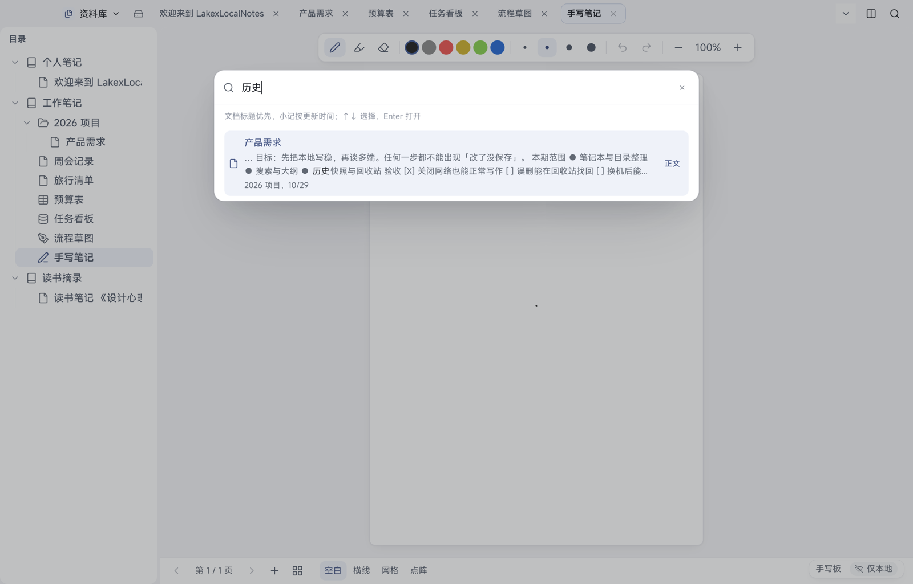

# 08 搜索、大纲与标签

[← 返回目录](README.md) | 上一章：[07 小记](07-quick-notes.md) | 下一章：[09 历史快照与回收站 →](09-history-trash.md)

## 全局搜索

- 桌面按 `⌘K`，或点顶部横条的放大镜
- 搜索范围是**文档标题与正文**，小记也在结果里
- 结果排序：文档标题优先，小记按更新时间
- 键盘操作：`↑` `↓` 选择，`Enter` 打开并定位命中处，`⌘Enter` 在新标签打开，`Esc` 关闭
- 选中结果会显示正文摘要，便于确认是不是要找的那篇

Android：点首页底部胶囊的放大镜，输入关键词，点结果进入文档。

### 索引

- 标题与正文的全文索引平时自动维护，新增与修改内容后不需要手动操作
- 如果搜索明显搜不到刚写的内容，可在「设置 → 日志 → 重建全文搜索索引」手动重建一次

## 文档内查找

- 桌面：在文档内按 `⌘F` 打开查找面板，输入关键词逐个跳转
- Android：工作区顶栏放大镜，弹出查找条，显示 `n/m` 命中数，用上下箭头切换，`×` 关闭
- 文档内查找只影响当前打开的文档，不改变内容

## 大纲

- 桌面右栏常驻大纲，显示当前文档的标题层级，点击跳到对应位置
- 「设置 → 编辑器 → 大纲增强」开启后，大纲支持筛选、折叠、显示级别徽标；关闭则用原生大纲
- 大纲按标题级别生成，所以**想让它有用，就用标题 1/2/3 组织文档**（不要用加粗假装标题）
- Android：工作区底部胶囊「大纲」打开大纲抽屉

## 标签

- 标签只用于**小记**，不给文档打标签（文档用笔记本与目录组织）
- 新建、重命名、置顶、排序、合并、删除都在小记页的标签栏与管理面板里
- 一条小记可有多个标签，一个标签可筛出多条小记

详见 [07 小记](07-quick-notes.md#标签)。

> 桌面目录栏的「筛选目录」只过滤目录树的显示，不会改动文档，也不等同于搜索。
