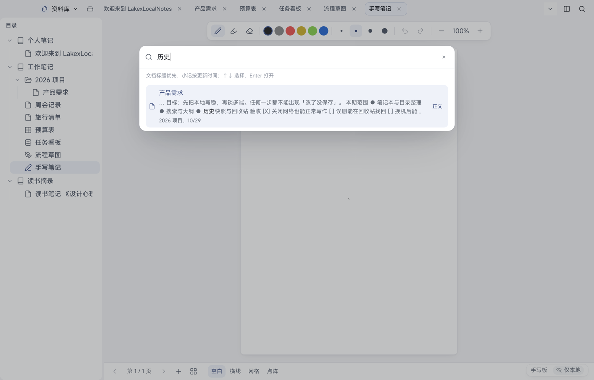
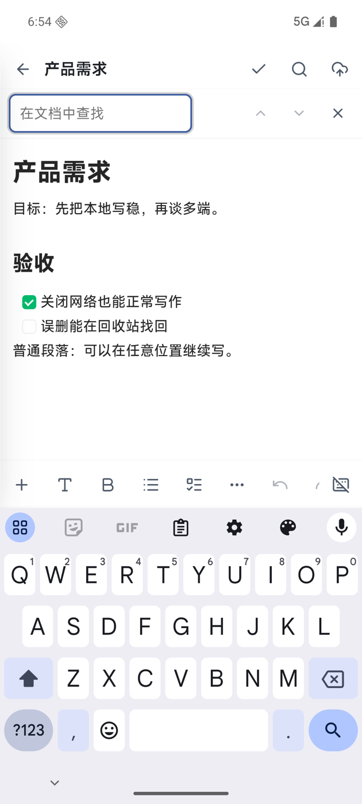
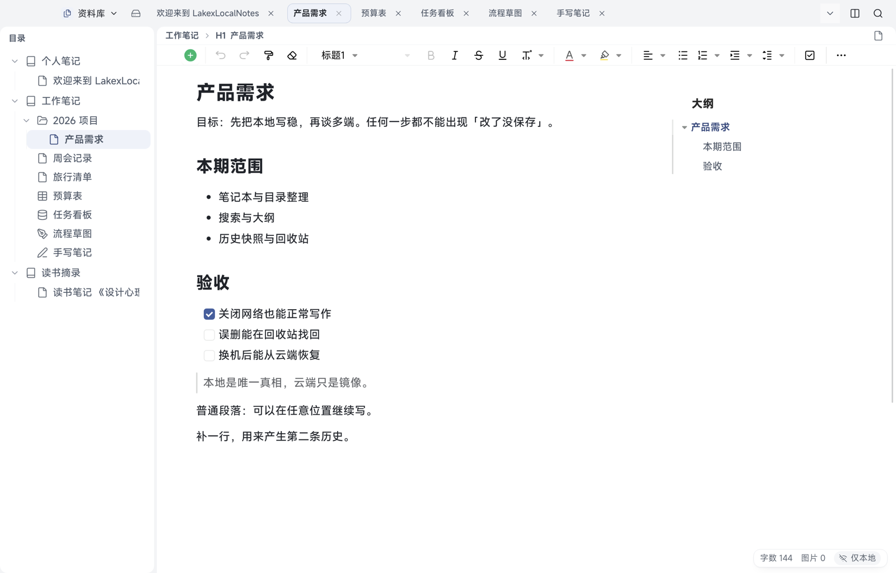

# 08 搜索、大纲与标签

[← 返回目录](README.md) | 上一章：[07 小记](07-quick-notes.md) | 下一章：[09 历史快照与回收站 →](09-history-trash.md)

## 全局搜索

- 桌面按 `⌘K`，或点顶部横条的放大镜
- 搜索范围是**文档标题与正文**，小记也在结果里
- 结果排序：文档标题优先，小记按更新时间
- 键盘操作：`↑` `↓` 选择，`Enter` 打开并定位命中处，`⌘Enter` 在新标签打开，`Esc` 关闭
- 选中结果会显示正文摘要，便于确认是不是要找的那篇

Android：点首页顶栏右侧的放大镜，输入关键词，点结果进入文档。

### 索引

- 标题与正文的全文索引平时自动维护，新增与修改内容后不需要手动操作
- 如果搜索明显搜不到刚写的内容，可在「设置 → 数据维护 → 全文搜索」手动重建一次

## 文档内查找

- 桌面：在文档内按 `⌘F` 打开查找面板，输入关键词逐个跳转
- Android：工作区顶栏放大镜，弹出查找条，显示 `n/m` 命中数，用上下箭头切换，`×` 关闭
- 文档内查找只影响当前打开的文档，不改变内容

## 大纲

- 桌面右栏常驻大纲，显示当前文档的标题层级，点击跳到对应位置
- 「设置 → 常规 → 大纲增强」开启后，大纲支持筛选、折叠、显示级别徽标；关闭则用原生大纲
- 大纲按标题级别生成，所以**想让它有用，就用标题 1/2/3 组织文档**（不要用加粗假装标题）
- Android：工作区底部胶囊（工作区小条）的「大纲」打开大纲抽屉

## 标签

标签是一套**小记与文档共用**的目录：同一个标签既可能出现在小记上，也可能出现在文档上。

### 给内容打标签

- 文档：右键文档 →「标签…」→「添加标签」；或打开文档「属性」里的标签行。可以输入新标签名，也可以选已有标签
- 小记：写作卡上的「标签」按钮；时间线上方也有标签栏
- 批量：桌面多选文档后右键「添加标签…」；Android 多选后点「打标签」；小记多选后可批量加标签

### 标签空间（桌面）

- 顶部空间菜单切到「标签」：只读聚合视图，显示每个标签下的文档与小记数量，点击条目可跳转
- 标签管理：新建、重命名、拖拽排序、合并、删除
- 侧栏「筛选目录」可以按标签包含/排除过滤目录树；它只影响显示，不会改动内容

### 标签页（Android）

- 首页底部 Dock 第 5 格「标签」：标签空间（全部 / 无标签 / 每个标签），管理入口支持新建、重命名、合并、删除、长按拖拽排序
- 文档与小记的标签都可以在这里看到聚合结果

### 规则与注意

- 标签名是目录的唯一来源；删除标签会移除它与文档/小记的关联，但**不会删除文档或小记**
- 一个标签可以有多条内容，一条内容可以有多个标签
- 小记转正式文档时，已有标签会一起继承

三条容易踩坑的定稿规则：

1. **顺序只属于这台设备**：标签集合与「哪条内容打了哪个标签」会同步，但**标签的显示顺序不会**。所以两台设备的标签顺序可以不一样；新建的标签总是追加到末尾，拖拽排序只记在本机。
2. **删除 = 缺席**：云端不保留标签墓碑。如果你在本机删了一个标签、另一台还显示着，**同步一次它就会消失**（不要以为没删掉）。
3. **桌面文档的标签关系也在同一本标签库里**：标签目录只有小记标签库这一份，桌面文档的标签关系在 261107 之后也迁到这里。所以查「某标签下有哪些内容」统一在标签空间看，别去别处找第二份。

> 桌面目录栏的「筛选目录」只过滤目录树的显示，不会改动文档，也不等同于搜索。
