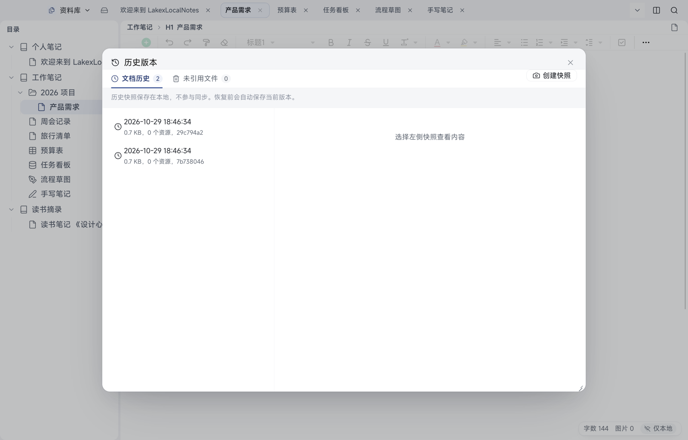
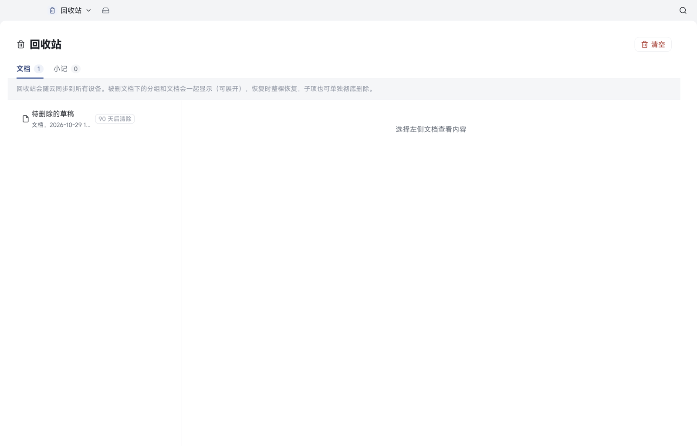
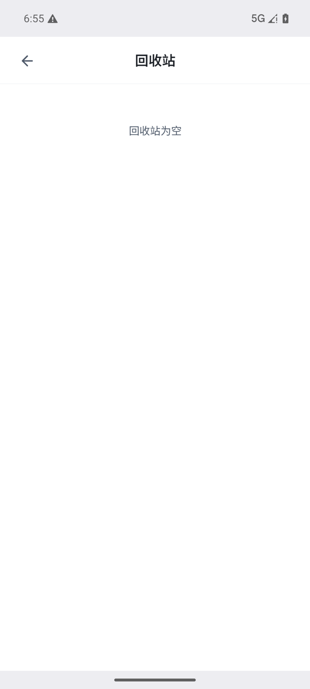

# 09 历史快照与回收站

[← 返回目录](README.md) | 上一章：[08 搜索、大纲与标签](08-search-outline-tags.md) | 下一章：[10 AI 助手 →](10-ai.md)

两道保险：**历史快照**救「改错了」，**回收站**救「删错了」。

## 历史快照

打开方式：目录里文档行「⋯」→「历史版本」。

| 区域 | 说明 |
| --- | --- |
| 文档历史 | 当前文档的快照列表，显示时间、大小、资源数量与标识 |
| 未引用文件 | 曾经属于这篇文档、现已不再引用的资源 |
| 创建快照 | 手动给当前内容打一个快照 |

- 快照保存在**本地**，不参与云同步
- **恢复快照前会自动保存当前版本**，所以恢复本身也可回退
- 除了手动快照，应用会按设置做自动快照；冲突被覆盖时也会强制留一份历史
- 详情面板里可以预览快照内容、删除单个快照

### 快照策略（设置 → 文档与历史）

| 设置项 | 作用 |
| --- | --- |
| 快照占用 | 显示当前快照数量与占用空间、上次清理时间 |
| 立即清理 | 立刻按策略清理一次 |
| 每文档上限 | 单篇文档最多保留多少份快照 |
| 保留天数 | 超期自动快照会被定期清理（手动快照与冲突留档另计） |
| 定期清理（小时） | 0 表示不自动清理 |
| 自动快照（分钟） | 0 表示不自动快照 |
| 一致性检查 | 只读体检正文文件、历史快照、未归属记录与引用资源，不会自动修复 |

> Android 端在设置里有「历史」入口，可查看历史相关设置与记录（能力与桌面不完全一致，界面为准）。

## 回收站

打开方式：桌面顶部「资料库」下拉 →「回收站」；Android 设置 → 回收站。

- 分「文档」与「小记」两个页签，分别统计条数

回收站里没有任何内容时，Android 端显示「回收站为空」。
- 删除的文档先进这里，默认 **90 天后自动清理**（可在设置 → 回收站里改天数，0 表示不自动清理）
- 删除一个分组或笔记本时，里面的内容一起进回收站，**恢复时整棵恢复**
- 在回收站里选中条目可以预览内容、恢复、或彻底删除（彻底删除会同时删除云端数据，不可撤销）
- 回收站内容随云同步到所有设备

### 「云端已删除（仅本地）」

如果一条文档在别的设备上被彻底删除了，而这台设备上还留着副本，回收站里会给它打上 **云端已删除（仅本地）** 的标记：

- 表示远端已经删干净，本机这份是可恢复的最后副本
- 这份副本不参与上传，只有你显式「恢复」并同步后才会重新回到云端
- 从未同步到过这台设备的文档，无法用这种方式找回

## 恢复语义

- 恢复 = 明确撤销删除：本机恢复后，下次同步会以本机为准重新上传并传播到其他设备
- 恢复不依赖网络：点恢复立刻生效，云端补拉/上传在后台进行
- 冲突时以先提交的一方为准，被覆盖的一方会留历史快照（见 [11](11-cloud-sync.md)）
