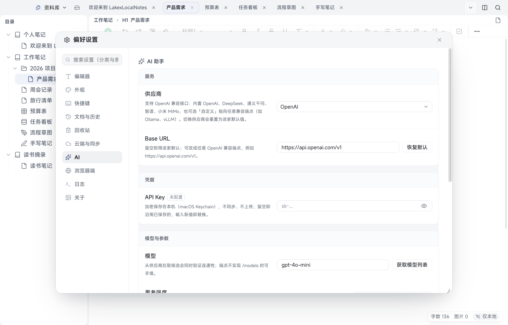
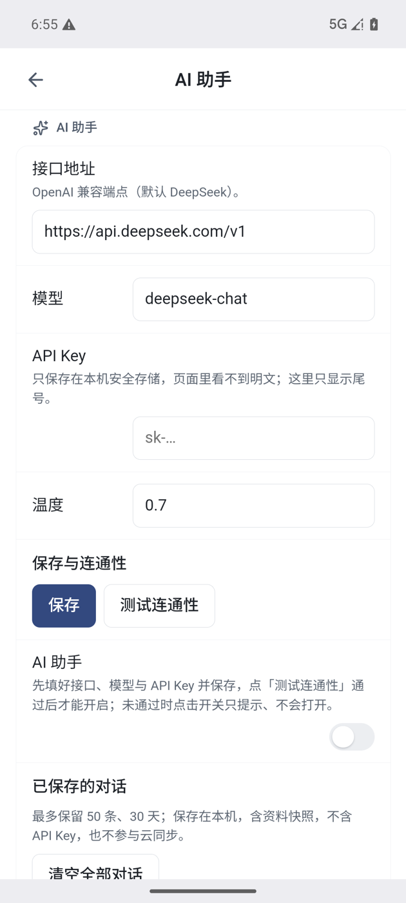

# 10 AI 助手

[← 返回目录](README.md) | 上一章：[09 历史快照与回收站](09-history-trash.md) | 下一章：[11 云同步 →](11-cloud-sync.md)

AI 助手需要你自己的模型服务（OpenAI 兼容接口）。没配置或没测试通过时，功能是关闭的。

## 配置

**桌面**：设置 → AI 助手

| 字段 | 说明 |
| --- | --- |
| 供应商 | 内置 OpenAI、DeepSeek、通义千问、智谱、小米 MiMo，也可选「自定义」指向任意兼容端点 |
| Base URL | 留空用该供应商默认值；可改成自建或代理地址 |
| API Key | 加密保存在本机（macOS 钥匙串），不同步、不上传；留空表示沿用已保存的 |
| 模型 | 输入模型名，或用「获取模型列表」从供应商拉取 |
| 温度 | 生成随机性，越低越稳定 |
| 多轮对话 | 同一面板内会带最近 40 条消息；对话**只存在内存**，关闭面板即清空（见下节） |
| AI 助手开关 | 在「连通性」分组里；配好密钥后可随时关闭，关闭后不出网，配置与 Key 保留 |

**Android**：设置 → AI 助手

| 字段 | 说明 |
| --- | --- |
| 供应商 | 与桌面同一份目录（OpenAI、DeepSeek、通义千问、智谱、小米 MiMo、自定义）；切换会用该家默认接口地址与模型 |
| 接口地址 | OpenAI 兼容端点；默认跟随所选供应商 |
| 模型 | 默认跟随所选供应商 |
| API Key | 只保存在本机安全存储，界面只显示尾号；**手机端只有一份 Key**，切换供应商后请确认它属于该家 |
| 思考强度 / 思考模式 | 只在该供应商支持时出现（如 DeepSeek）；开启思考模式时温度不生效 |
| 温度 | 默认 0.7；思考模式开启时隐藏 |
| 保存 / 测试连通性 | 先保存，再测试；测试通过后才能打开开关 |
| 开关 | 未通过测试时点击只提示，不会打开 |
| 已保存的对话 | 最多 50 条、30 天，保存在本机，含资料快照，不含 API Key，不参与云同步 |

> 换供应商会重置为该供应商的默认地址与模型，需要的话再改。供应商选择只记在本机，不参与同步。

## 入口

桌面三个入口，打开的是同一个面板：

1. 选中文字后，选区浮栏上的 AI 按钮
2. 块句柄菜单里的 AI
3. 顶栏的 AI 入口

Android：首页底部 Dock 第 4 格「AI」（就是 AI 助手；手机端没有 AI 写作空间）。

## 桌面：对话只存在内存（不保存）

桌面的 AI 助手是**用完即走**的：

- 对话**只存在内存里**——关闭面板、关掉当前文档或标签，这一份对话就没了；应用退出后也不会留下任何聊天记录
- 它**不写进笔记**、不进文档历史、不进云同步、没有「历史对话」入口（要看历史只有文档自己的版本快照，跟 AI 对话无关）
- 「钉住」只影响显示：钉住后切到别的文档会**挂起**（切回来还能接着聊），但**应用退出照样全部丢失**
- 想保留结果就把它**插入正文 / 替换选中内容**——落到文档里的内容才会被保存、才会有历史版本

这与另外两件事不同，别混：

| 是什么 | 存在哪 | 关闭/退出后 |
| --- | --- | --- |
| **桌面 AI 助手**（本章） | 只在内存（按文档作用域） | **全部丢失** |
| **AI 写作**（桌面 `⌘4`，见 [17](17-ai-writing.md)） | 本机数据库 + 左栏「历史记录」 | 会话还在，可重开；但只存本机、不进同步、换机不跟过去 |
| **文档历史**（见 [09](09-history-trash.md)） | 本机历史快照 | 是正文的版本，和 AI 对话无关 |

> 手机端的 AI 助手不一样：它会把会话存在本机（「已保存的对话」，最多 50 条 / 30 天，见上面的 Android 配置表），也不会进云同步。

## 能做什么

- 改写、润色、续写、缩写、翻译、总结
- 对选中内容提问
- 图片与 PDF 的文字解析（PDF 文本在主进程解析，只把需要的文本交给模型）
- 结果可以「替换选中内容」或「插入到下方」

## 资料集

- 面板里可以附带参考资料（当前文档、选中片段等），让模型基于你的资料回答
- 资料条旁会显示用量；超出预算会明确提示，不会静默截断
- 只把你要处理的文本发给你配置的供应商，应用本身不收集内容

## 隐私

- API Key 只保存在本机，不写入笔记、不进备份、不参与同步
- 模型请求直接发往你配置的地址，不经过本项目的中转

## 和 AI 写作的区别

这一章讲的是**文档里的 AI 助手**（选中文字改写、提问、图片与 PDF 解析）。如果你想的是「和 AI 连着聊、让它一次性写一篇长文」，那是桌面专属的 **AI 写作空间**，见 [17 AI 写作](17-ai-writing.md)。

- 两者共用同一份供应商配置（都在设置 → AI 助手）
- AI 助手不产生会话历史（关掉面板即清空记忆）；AI 写作的会话会留在本机左栏
- AI 写作的答案用内核只读视图渲染，且能一键「生成文档」或「保存到小记」
