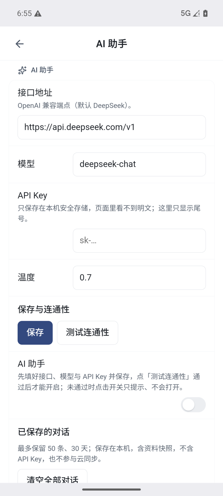

# 10 AI 助手

[← 返回目录](README.md) | 上一章：[09 历史快照与回收站](09-history-trash.md) | 下一章：[11 云同步 →](11-cloud-sync.md)

AI 助手需要你自己的模型服务（OpenAI 兼容接口）。没配置或没测试通过时，功能是关闭的。

## 配置

**桌面**：设置 → AI

| 字段 | 说明 |
| --- | --- |
| 供应商 | 内置 OpenAI、DeepSeek、通义千问、智谱、小米 MiMo，也可选「自定义」指向任意兼容端点 |
| Base URL | 留空用该供应商默认值；可改成自建或代理地址 |
| API Key | 加密保存在本机（macOS 钥匙串），不同步、不上传；留空表示沿用已保存的 |
| 模型 | 输入模型名，或用「获取模型列表」从供应商拉取 |
| 温度 | 生成随机性，越低越稳定 |
| 多轮对话 | 同一面板内会带最近 40 条消息，关闭面板后记忆清空 |
| AI 助手开关 | 在「连通性」分组里；配好密钥后可随时关闭，关闭后不出网，配置与 Key 保留 |

**Android**：设置 → AI 助手

| 字段 | 说明 |
| --- | --- |
| 接口地址 | OpenAI 兼容端点，默认 DeepSeek |
| 模型 | 默认 `deepseek-chat` |
| API Key | 只保存在本机安全存储，界面只显示尾号 |
| 温度 | 默认 0.7 |
| 保存 / 测试连通性 | 先保存，再测试；测试通过后才能打开开关 |
| 开关 | 未通过测试时点击只提示，不会打开 |
| 已保存的对话 | 最多 50 条、30 天，保存在本机，含资料快照，不含 API Key，不参与云同步 |

> 换供应商会重置为该供应商的默认地址与模型，需要的话再改。

## 入口

桌面三个入口，打开的是同一个面板：

1. 选中文字后，选区浮栏上的 AI 按钮
2. 块句柄菜单里的 AI
3. 顶栏的 AI 入口

Android：首页底部胶囊右侧的 AI 助手。

## 能做什么

- 改写、润色、续写、缩写、翻译、总结
- 对选中内容提问
- 图片与 PDF 的文字解析（PDF 文本在主进程解析，只把需要的文本交给模型）
- 结果可以「替换选中内容」或「插入到下方」

## 资料集

- 面板里可以附带参考资料（当前文档、选中片段等），让模型基于你的资料回答
- 资料条旁会显示用量；超出预算会明确提示，不会静默截断
- 只把你要处理的文本发给你配置的供应商，应用本身不收集内容

## 隐私

- API Key 只保存在本机，不写入笔记、不进备份、不参与同步
- 模型请求直接发往你配置的地址，不经过本项目的中转
