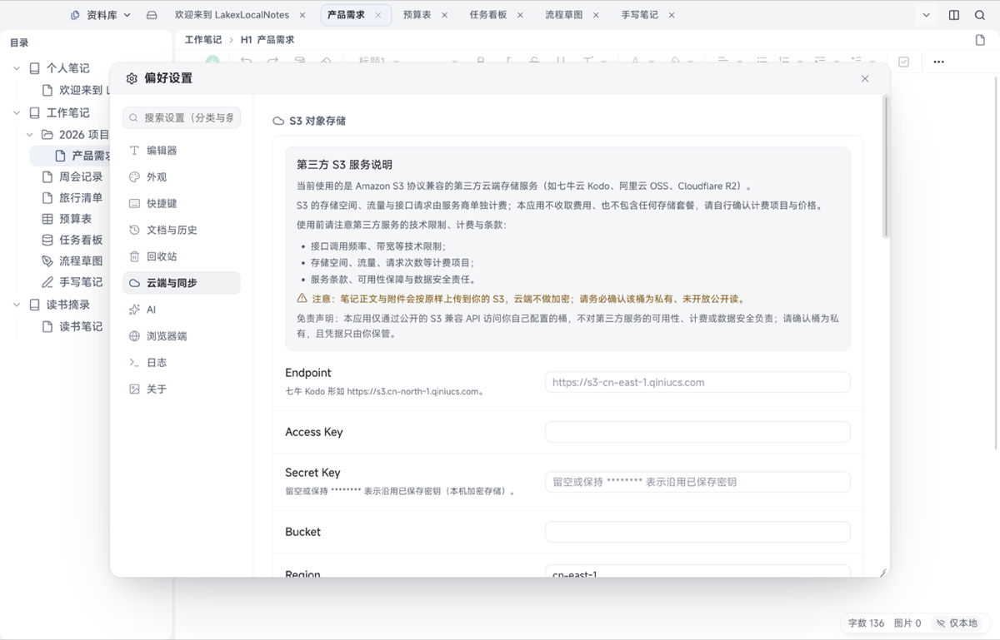
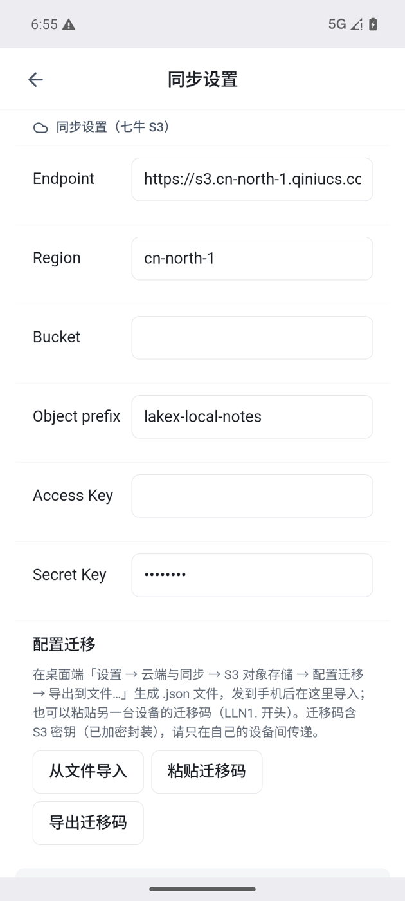

# 11 云同步

[← 返回目录](README.md) | 上一章：[10 AI 助手](10-ai.md) | 下一章：[12 设置项逐条 →](12-settings.md)

云同步用**你自己的**对象存储当多端镜像。没有配置时，应用完全不出网。

## 前提

- 一个 S3 兼容的存储桶（例如七牛云 Kodo、阿里云 OSS、Cloudflare R2）
- 该桶必须是**私有**的：笔记正文与附件会按原样上传，**云端不做加密**
- 桶的 Endpoint、Access Key、Secret Key、Bucket、Region

## 桌面配置

设置 → 云端与同步 → S3 对象存储：

| 字段 | 说明 |
| --- | --- |
| Endpoint | 服务商给的 S3 端点，例如七牛形如 `https://s3.cn-north-1.qiniucs.com` |
| Access Key / Secret Key | 你的密钥。Secret Key 留空或保持掩码表示沿用已保存的 |
| Bucket / Region | 桶名与区域 |
| 保存配置 | 保存后「测试连接」才能验证是否可用 |
| 测试连接 | 通过后才能打开云同步开关 |

### 配置迁移

桌面在「配置迁移」里可以：

- **导出到文件…**：生成一个只含 S3 配置的 `.json`，文件里的密钥已加密，**不要外传**
- **从文件导入…**
- **粘贴迁移码…**：另一台设备导出的迁移码（`LLN1.` 开头）

导入会**覆盖本机 S3 配置**。迁移码只是加密封装，**不是安全边界**：固定种子，任何拿到这份文件或将迁移码的人都能解开，所以别外传、别贴到聊天工具。

> 桌面导出/导入在**主进程**里完成，界面层从不接触明文 Secret；手机上密钥走系统安全存储。

## Android 配置

设置 → 云端与同步：

- 字段与桌面一致：Endpoint、Region、Bucket、Object prefix、Access Key、Secret Key
- 「配置迁移」三个按钮：从文件导入、粘贴迁移码、导出迁移码
- 桌面导出的 `.json` 发到手机后，选「从文件导入」选择它即可，免去逐项填写
- 手机上建议开启「按需下载附件」（见下），首次同步更快、更省流量

## 启用云同步

- 位置：设置 → 云端与同步 → 同步策略 →「启用云同步」（这个开关只保存在当前设备）
- **先完成配置并「测试连接」通过**，再打开开关；没配好就点，界面只会提示，不会开始同步
- 开关旁的提示固定为「隐私数据（云端不加密）」：确认这个桶是私有的、凭据只有你持有

## 同步怎么跑

- 打开或关闭应用时各同步一次（手动模式下不补；「手动」= 真正不出网）
- 顶部同步状态可查看同步进度与结果；开启后不需要手动点保存
- 同步顺序：先拉远端、判定冲突，再推本地；只同步变化的部分
- 冲突判定：先拉远端，**远端已发布的版本胜出**，被覆盖的一方自动留历史快照（所以最终是「先同步上去的那一版」赢；见下节）

### 按需下载附件（省流量）

设置 → 云端与同步 → 同步策略 →「按需下载附件」（桌面）或 Android 同步设置里的同名开关：

- 开启后首次同步**只拉文档与附件清单**，图片和附件在你打开或预览时才下载
- 移动端列表卡与预览里的图片本来就按缩略图（1024px）显示，看原图才取原件
- 关闭则首次同步全量下载，离线最完整。库很大、用手机流量同步时值得打开

## 多端同步的正确表现

同步不是「整篇互相覆盖」，而是分两条线各走各的：**位置**（这篇笔记在哪个笔记本、在不在回收站）和**内容**（正文、标题、标签……）。两条线互不覆盖，所以不少「看起来数据要丢了」的情况其实是设计内的正常表现。

### 先记住三个模型

1. **回收站就是一个特殊的笔记本**。「删除」不是把笔记从世界上抹掉，而是把它**移进「回收站」这本笔记本**：正文、附件、历史快照都还在。真正的永久删除是回收站里的「彻底删除」，那一步不可复原（细节见 [09 历史快照与回收站](09-history-trash.md)）。
2. **移动和删除都是「位置变更」，会传播**：A 端把笔记移到别的笔记本或移进回收站，同步后其它端会跟着移动。这期间 B 端对正文的编辑**不会丢** —— 同步时**内容按远端、位置按本地**各走各的，再同步一次两边就一致。
3. **编辑锁 = 本机只读保护标记，会传播**：某台设备把文档设成「锁定（只读）」，同步后其它端也会看到它是锁定、只能读。锁只是防误改，不等于删除或移走；**你在锁生效前写下的内容仍会保存**，不会因为变只读而丢。

### 冲突：只有「正文」才叫冲突

- 两端都改了同一篇**正文** ⇒ 同步时**远端已发布的版本胜出**，被覆盖的版本自动进该端的历史快照（不会静默丢字）。换句话说：谁先同步上去，谁的版本就是远端；后同步的一端会看到远端那版，自己这版留在「历史版本」里。
- **移动/删除不算正文冲突**：它们是位置变更，走位置那条线；不会因为另一端改了正文而被回滚。
- 两端都动了同一篇的位置（同时移动或删除）⇒ 以先同步上去的为准。

### 恢复必须显式

- 从回收站「恢复」是**显式动作**：只有在回收站里点了恢复才会撤销删除。另一台设备编辑过这篇，**不会**让它自动复活。
- 但**他端的显式恢复会传播**：A 端恢复并同步后，其它端会把这条从回收站挪回原位置。原父目录已被删除或也在回收站时，会回落到默认笔记本（日记条目会回日记空间）。
- 「云端已删除（仅本地）」的副本是例外：它**只读、不参与同步**，是这台设备上的最后副本；你想留下就点恢复（会重新回到云端）。如果你在另一台还看到这篇，先让它同步一次：正常的话它要么消失，要么进回收站并带上这个标记。

### 判断题：遇到这些现象，是正常还是该紧张？

| 你可能遇到的现象 | 判断 |
| --- | --- |
| 我在手机上把笔记移进回收站，电脑同步后也不见了 | **正常**：删除 = 移进回收站，会传播。想找回，在任一端的回收站里恢复即可。 |
| 我在这台把文档移到别的笔记本，另一台还显示旧位置，但它刚改的正文已经过来了 | **正常**：位置和内容各走各的线。再同步一次位置就会跟上，正文不会丢。 |
| 另一台设备上这篇文档突然变成只读，我没设过 | **正常**：另一台给它加了编辑锁，锁会传播。到加锁的那端解锁即可；你在锁生效前写的内容仍然会保存。 |
| 两端都改了同一篇，我这版「没了」 | **正常**：远端胜出，你那版在「历史版本」里可以找回（见 [09](09-history-trash.md)），不是被静默丢弃。 |
| 我给文档加了锁，以为别的设备就不会再同步它了 | **理解错了**：锁只防误改，不阻止同步（它本身还会传播给其它端）。想让某台设备完全不出网，请关掉「启用云同步」（关闭 = 完全没配置）。 |

> 回收站/历史快照的细节见 [09](09-history-trash.md)，锁的入口见 [02 笔记本与目录](02-notebooks.md)，同步失败的排查见 [14 常见问题](14-faq.md)。

## 备份与恢复

- **整库备份到…**：把数据库、全部笔记与资源、历史快照、小记导出到所选目录（不覆盖非空目录）
- **从云端恢复（换机）**：当前数据先改名隔离保存，再从云端全量拉取重建；**不会**把本机数据传上去。用于换机或本地库损坏
- **导出便携包（桌面 → 手机）**：不想让手机首轮全量走 S3 时，桌面导出一个 `.zip.lln` 让手机覆盖导入，之后 S3 只做增量

换机到底该选便携包、S3 还是迁移码，见 [18 换机、便携包与迁移](18-portable-and-migrate.md)。

## 关闭云同步

- 关闭 = 完全没配置：任何路径都不出网，界面显示「仅本地」
- 已经配过 S3 但把开关关掉，状态同样是「仅本地」，不会被误显示成「待同步」
- 关闭不会删除云端已有数据，也不会删除本地数据；重新打开后继续增量同步

## 出问题时

- 先在设置里「测试连接」；失败时看错误文案（密钥错、桶不存在、区域不对、跨域/权限）
- 顶部同步状态里看失败原因与分类（可重试 / 需处理 / 致命）
- 手机端「设置 → 云端与同步」常驻显示上次同步时间与结果，离线没尝试也会写清楚

更多见 [14 常见问题](14-faq.md)。
