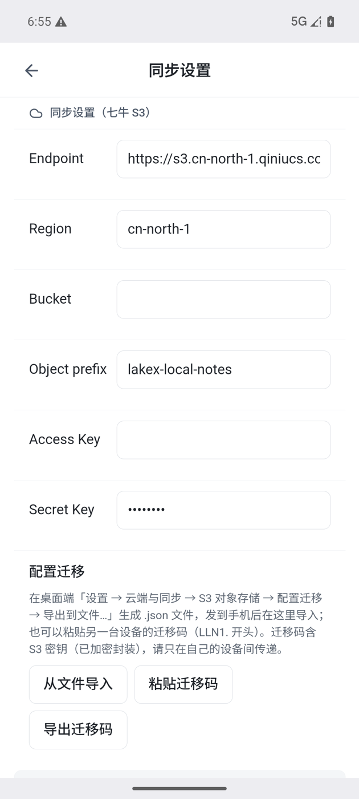

# 11 云同步

[← 返回目录](README.md) | 上一章：[10 AI 助手](10-ai.md) | 下一章：[12 设置项逐条 →](12-settings.md)

云同步用**你自己的**对象存储当多端镜像。没有配置时，应用完全不出网。

## 前提

- 一个 S3 兼容的存储桶（例如七牛云 Kodo、阿里云 OSS、Cloudflare R2）
- 该桶必须是**私有**的：笔记正文与附件会按原样上传，**云端不做加密**
- 桶的 Endpoint、Access Key、Secret Key、Bucket、Region

## 桌面配置

设置 → 云端与同步 → S3 对象存储：

| 字段 | 说明 |
| --- | --- |
| Endpoint | 服务商给的 S3 端点，例如七牛形如 `https://s3.cn-north-1.qiniucs.com` |
| Access Key / Secret Key | 你的密钥。Secret Key 留空或保持掩码表示沿用已保存的 |
| Bucket / Region | 桶名与区域 |
| 保存配置 | 保存后「测试连接」才能验证是否可用 |
| 测试连接 | 通过后才能打开云同步开关 |

### 配置迁移

桌面在「配置迁移」里可以：

- **导出到文件…**：生成一个只含 S3 配置的 `.json`，文件里的密钥已加密，**不要外传**
- **从文件导入…**
- **粘贴迁移码…**：另一台设备导出的迁移码（`LLN1.` 开头）

导入会**覆盖本机 S3 配置**。迁移码只是加密封装，不是安全边界。

## Android 配置

设置 → 同步设置：

- 字段与桌面一致：Endpoint、Region、Bucket、Object prefix、Access Key、Secret Key
- 「配置迁移」三个按钮：从文件导入、粘贴迁移码、导出迁移码
- 桌面导出的 `.json` 发到手机后，选「从文件导入」选择它即可，免去逐项填写

## 启用云同步

- 位置：设置 → 云端与同步 → 同步策略 →「启用云同步」（这个开关只保存在当前设备）
- **先完成配置并「测试连接」通过**，再打开开关；没配好就点，界面只会提示，不会开始同步
- 开关旁的提示固定为「隐私数据（云端不加密）」：确认这个桶是私有的、凭据只有你持有

## 同步怎么跑

- 打开或关闭应用时各同步一次（手动模式下不补；「手动」= 真正不出网）
- 顶部同步状态可查看同步进度与结果；开启后不需要手动点保存
- 同步顺序：先拉远端、判定冲突，再推本地；只同步变化的部分
- 冲突判定：先提交的一方为准，被覆盖的一方会自动留历史快照（见 [09](09-history-trash.md)）

## 备份与恢复

- **整库备份到…**：把数据库、全部笔记与资源、历史快照、小记导出到所选目录（不覆盖非空目录）
- **从云端恢复（换机）**：当前数据先改名隔离保存，再从云端全量拉取重建；**不会**把本机数据传上去。用于换机或本地库损坏

## 关闭云同步

- 关闭 = 完全没配置：任何路径都不出网，界面显示「仅本地」
- 已经配过 S3 但把开关关掉，状态同样是「仅本地」，不会被误显示成「待同步」
- 关闭不会删除云端已有数据，也不会删除本地数据；重新打开后继续增量同步

## 出问题时

- 先在设置里「测试连接」；失败时看错误文案（密钥错、桶不存在、区域不对、跨域/权限）
- 顶部同步状态里看失败原因与分类（可重试 / 需处理 / 致命）
- 手机端「设置 → 同步设置」常驻显示上次同步时间与结果，离线没尝试也会写清楚

更多见 [14 常见问题](14-faq.md)。
