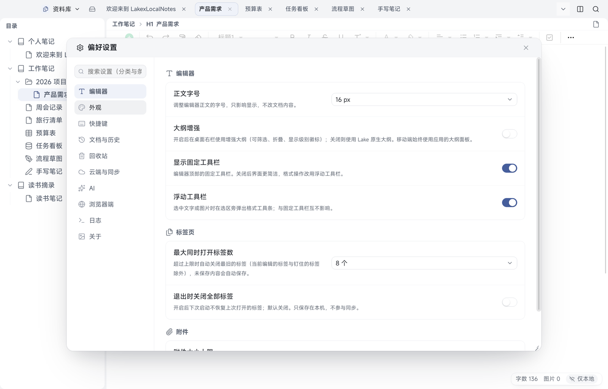
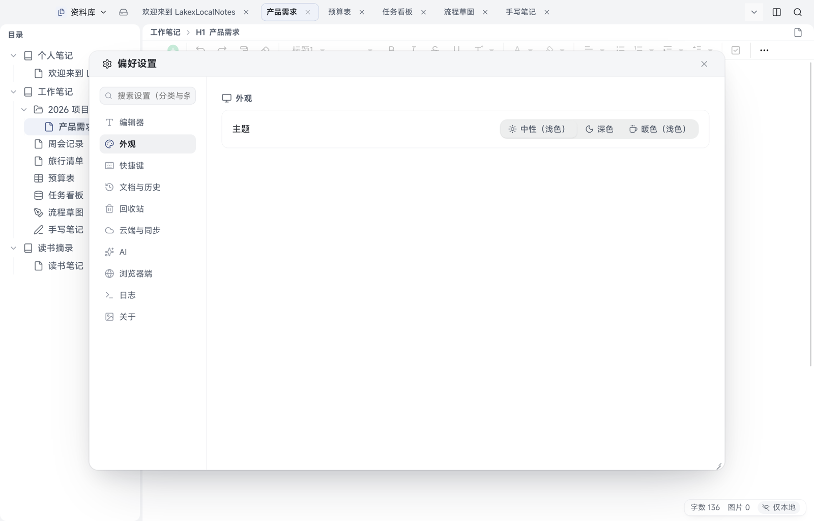
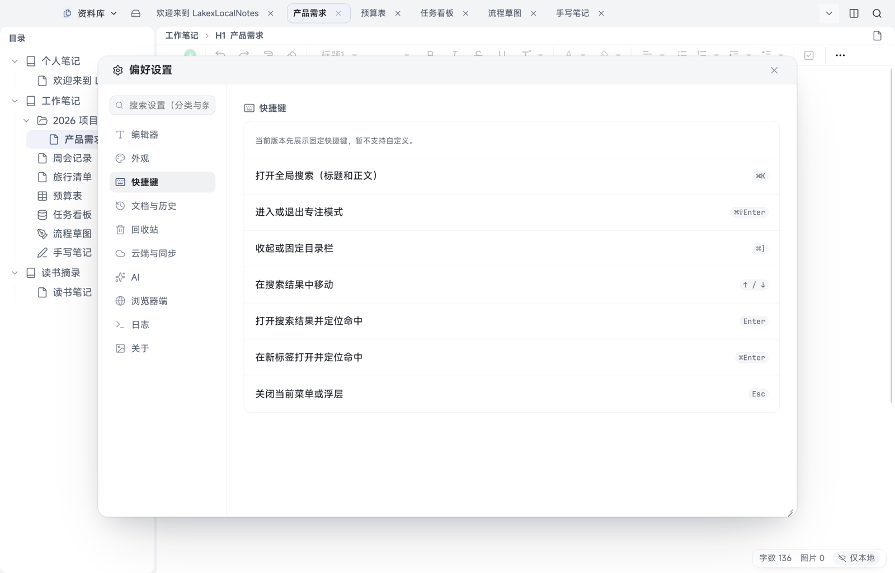
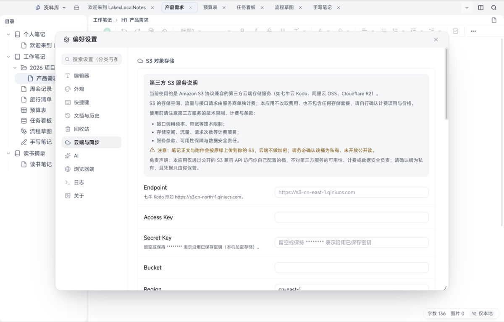
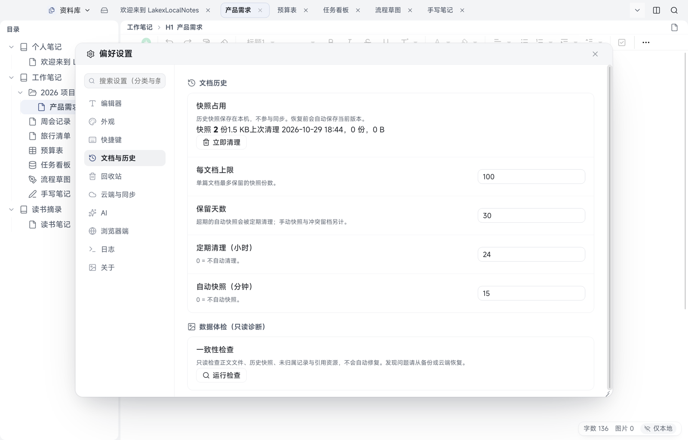
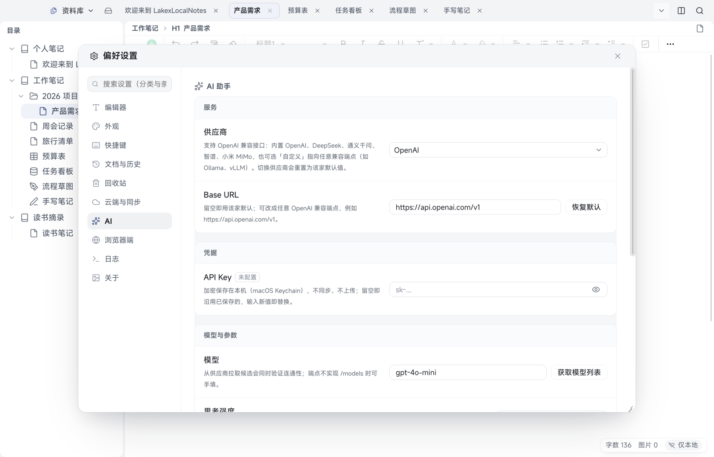
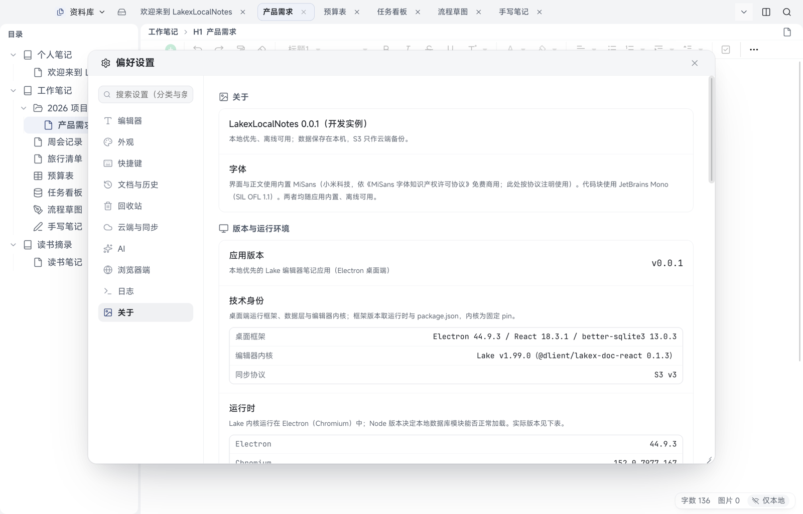
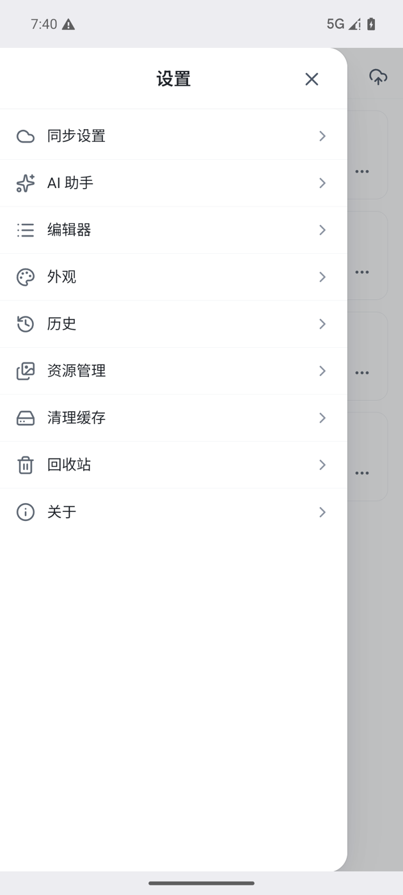
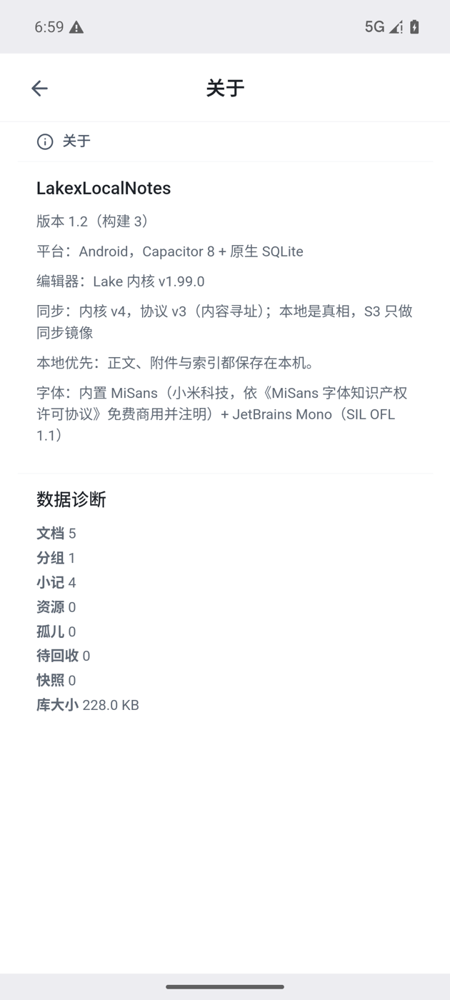
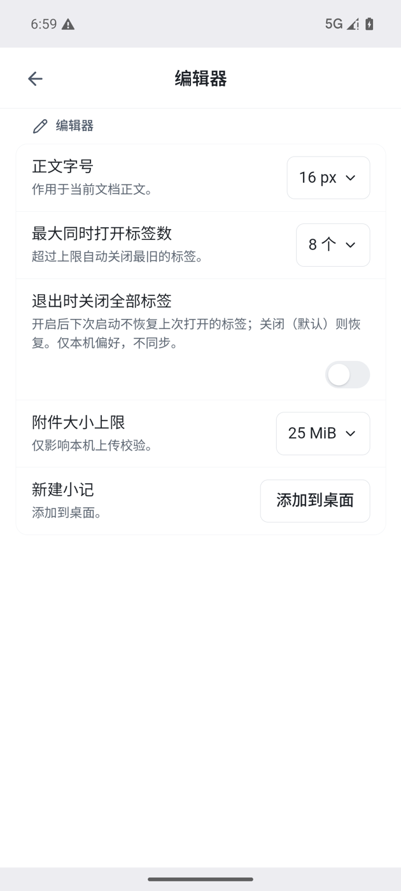

# 12 设置项逐条

[← 返回目录](README.md) | 上一章：[11 云同步](11-cloud-sync.md) | 下一章：[13 快捷键 →](13-shortcuts.md)

- **桌面**：左上空间菜单 →「偏好设置」（也可按 `⌘,` 或从应用菜单打开）。左侧分类依次是：常规、外观、快捷键、云端与同步、备份与恢复、数据与历史、数据维护、浏览器端、AI 助手、更新、关于
- **Android**：首页左上角齿轮。根菜单依次是：常规、外观、云端与同步、备份与恢复、历史、导入、资源管理、清理缓存、回收站、AI 助手、更新中心、关于；右上角「×」直接回首页
- 桌面设置页顶部有搜索框：输入「自动备份」「迁移码」「体检」这类词，可以按分类或按条目直接跳过去

## 桌面设置

### 常规

| 设置项 | 说明 |
| --- | --- |
| 正文字号 | 只影响显示，不改文档内容，默认 16 px |
| 大纲增强 | 开启后右栏用增强大纲（可筛选、折叠、显示级别徽标）；关闭用原生大纲 |
| 显示固定工具栏 | 编辑器顶部固定工具栏，关闭后界面更简洁 |
| 浮动工具栏 | 选中文字或图片时在选区旁弹出格式工具条，与固定工具栏互不影响 |
| 最大同时打开标签数 | 超过上限自动关闭最旧的标签（当前编辑的标签与钉住的标签除外），未保存内容会自动保存，默认 8、上限 16；**文档与日记各自计数** |
| 退出时关闭全部标签 | 开启后下次启动不恢复上次打开的标签；默认关闭，只保存在本机 |
| 附件大小上限 | 插入附件时的本机上限。同步与下载仍按协议上限走，不受别的设备设置影响 |
| 默认空间 | 启动时落在哪个一级空间（知识库 / 小记 / 日记 / AI 写作 / 标签）。只记在本机，任何时候都能用 `⌘1`–`⌘5` 切换 |

### 外观

主题三选一：中性（浅色）、深色、暖色（浅色）。主题只改变观感，不影响数据。

### 快捷键

当前版本先展示固定快捷键，**暂不支持自定义**。完整清单见 [13 快捷键](13-shortcuts.md)。

### 云端与同步

| 区块 | 内容 |
| --- | --- |
| S3 对象存储 | 服务说明与计费提示，Endpoint、Access Key、Secret Key、Bucket、Region、保存配置、测试连接 |
| 配置迁移 | 导出到文件…、从文件导入…、粘贴迁移码…（只含 S3 配置，导入会覆盖本机配置，文件含加密后的密钥） |
| 同步策略（仅保存在当前设备） | 启用云同步、「隐私数据（云端不加密）」提示、自动同步模式与间隔、**按需下载附件** |
| 云端回收 | 回收状态、回收窗口（天）、自动对账周期；删除记录只读 |
| 同步诊断 | 最近 3 轮同步的耗时、对象数与失败项，可复制发给维护者 |

- **按需下载附件**：开启后首次同步只拉文档与附件清单，图片和附件在打开或预览时才下载（更快、更省流量）；关闭则首次同步全量下载
- **自动同步模式**：选「手动」就完全不出网（等于只在本机）；自动模式按开/关应用与间隔触发

详见 [11 云同步](11-cloud-sync.md)。

### 备份与恢复

| 区块 | 内容 |
| --- | --- |
| 备份 | 整库备份（完整目录）：数据库快照 + 正文/资源/历史快照 + 小记，导出到所选目录 |
| 自动备份（仅数据库） | 启用开关、备份间隔（每天 / 每周）、保留份数；只备份主库与小记库，**不含正文与资源** |
| 存储占用 | 数据库快照的份数与总大小；按「保留份数」与总大小上限删最旧的 |
| 上次数据库备份结果 | 最近一次成功/部分成功/失败及原因 |
| 恢复 | 从数据库快照恢复（校验后原库改名隔离再替换）、从云端恢复（换机/坏库，不会上传本机数据） |
| 迁移到手机 | **导出便携包（桌面 → 手机）**：全部数据（不含历史快照）打成一个 `.zip.lln`，上限 4GiB |

便携包每条细节（含不包含什么、失败面）见 [18 换机、便携包与迁移](18-portable-and-migrate.md)。

### 数据与历史

| 设置项 | 说明 |
| --- | --- |
| 快照占用 | 当前快照份数与占用空间、上次清理时间 |
| 立即清理 | 手动触发一次清理 |
| 每文档上限 | 单篇最多保留的快照份数 |
| 保留天数 | 超期自动快照会被定期清理（手动快照与冲突留档另计） |
| 定期清理（小时） | 0 = 不自动清理 |
| 自动快照（分钟） | 0 = 不自动快照 |

### 数据维护

| 区块 | 内容 |
| --- | --- |
| 回收站 | 回收站自动过期（天）：0 = 关闭；到期彻底删除（含云端），不可撤销 |
| 全文搜索 | 重建全文搜索索引（平时自动维护，索引异常或换分词器后手动重建） |
| 数据体检（只读诊断） | 一致性检查：正文文件、历史快照、未归属记录与引用资源，只报告不修复 |
| 后台扫描间隔（小时） | 低频的「文件 ↔ 元数据」扫描间隔，**只报告不写库**；默认 24 小时，0 = 关闭（手动「重建数据 → 扫描」仍可用） |
| 数据恢复（手动） | 重建数据：正文文件还在、笔记行丢了时，从正文补回元数据行（不改写、不删正文） |
| 应用日志（只读） | 主进程日志，按关键字过滤，每条命中带上下文 |

> 数据不对劲时先跑这三个自愈入口：**一致性检查**、**重建全文搜索索引**、**重建数据**；坏库再走「从云端恢复」。见 [14 常见问题](14-faq.md)。

### 浏览器端

| 设置项 | 说明 |
| --- | --- |
| 启用浏览器端 | 在本机浏览器打开同一个本地库，只监听 `127.0.0.1:19880`，不向局域网开放 |

- 开关即时生效，但**不保存**：应用每次启动都从关闭开始
- 浏览器里读写的是本机同一份数据；同步进度与待办实时刷新
- 可以当「分屏阅读器」用：开着它，用浏览器自己的并排窗口左右看两篇；需要系统目录框的操作（导出、整库备份）仍在桌面端做
- 「另存为」走浏览器下载，附件在新标签打开

### AI 助手

供应商、Base URL、API Key、模型（获取模型列表）、温度、思考强度/思考模式、测试连通性，以及「连通性」分组里的开关（配好密钥后可随时关闭，关闭后不出网）。详见 [10 AI 助手](10-ai.md)；AI 写作空间（`⌘4`）共用这份配置，见 [17](17-ai-writing.md)。

### 更新

| 区块 | 内容 |
| --- | --- |
| 版本与检查 | 当前版本与上次检查时间、「检查更新」按钮、「状态」行 |
| 自动更新 | 自动检查开关 + 检查频率（关闭 / 6 / 12 / 24 小时）、自动下载开关 |
| 更新日志 | 当前版本及历史版本的更新内容（与 GitHub Release 同源） |
| 可用更新 | 发现新版本时出现：版本、发布日期、大小、更新内容、下载安装包 / 前往发布页 / 忽略此版本 |

详见 [19 更新中心](19-update-center.md)。

### 关于

显示应用版本、字体说明（MiSans 与 JetBrains Mono）、技术身份与运行时信息、内容统计与各类目录（数据目录、工作空间、资源、历史快照、日志），以及「复制诊断信息」。反馈问题时贴诊断信息最省事。

## Android 设置

| 菜单 | 内容 |
| --- | --- |
| 常规 | 正文字号、最大同时打开标签数（文档与日记各自计数，最多 16）、退出时关闭全部标签、默认空间、附件大小上限（默认 25 MiB）、把「新建小记」添加到桌面 |
| 外观 | 主题：浅色、深色 |
| 云端与同步 | S3 配置字段与配置迁移（从文件导入、粘贴迁移码、导出迁移码）、启用云同步、自动同步模式与间隔、按需下载附件，详见 [11](11-cloud-sync.md) |
| 备份与恢复 | 从云端恢复、从便携包导入（覆盖本机）、修复缺失数据（缺正文 / 缺小记），详见 [18](18-portable-and-migrate.md) |
| 历史 | 每文档快照上限、保留天数、自动快照间隔、定期清理间隔，以及查看与恢复 |
| 导入 | 默认笔记本：系统分享进来的 `.md` 落到哪本笔记本 |
| 资源管理 | 本地资源占用、未引用的本地文件、云端未引用文件，以及「缺正文」「缺小记」分组 |
| 清理缓存 | 清理本机缓存（不影响笔记内容） |
| 回收站 | 已删除的文档与小记，见 [09](09-history-trash.md) |
| AI 助手 | 接口地址、模型、API Key、温度、保存与测试连通性、开关、已保存对话（最多 50 条 30 天）、清空全部对话 |
| 更新中心 | 检查更新、自动检查与间隔、自动下载、仅 Wi-Fi 自动下载、更新日志，见 [19](19-update-center.md) |
| 关于 | 版本、平台、内置字体说明与数据诊断（文档、分组、小记、资源、快照数量与库大小），可截图反馈问题 |

