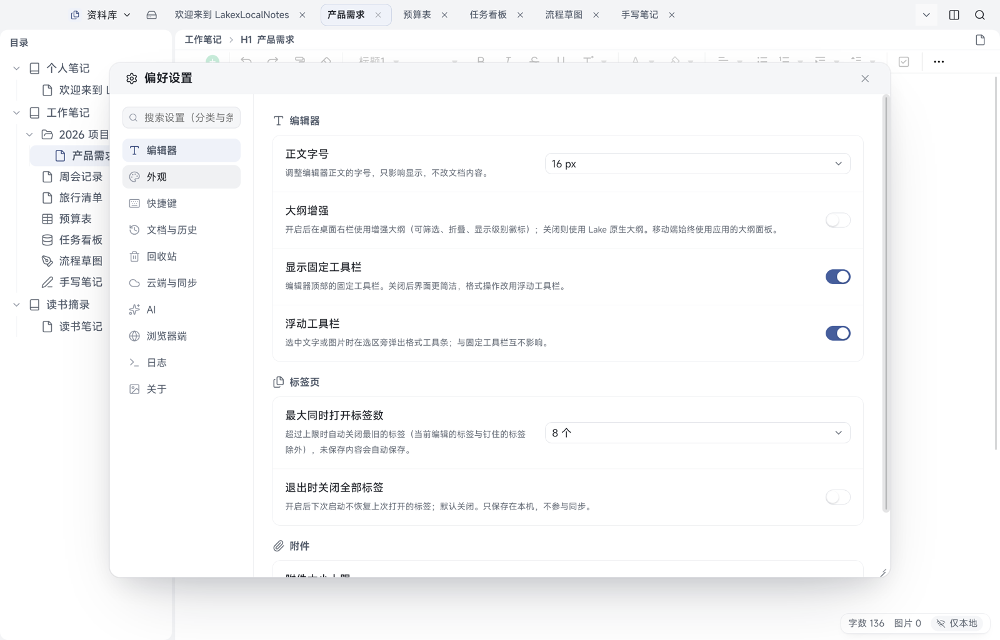
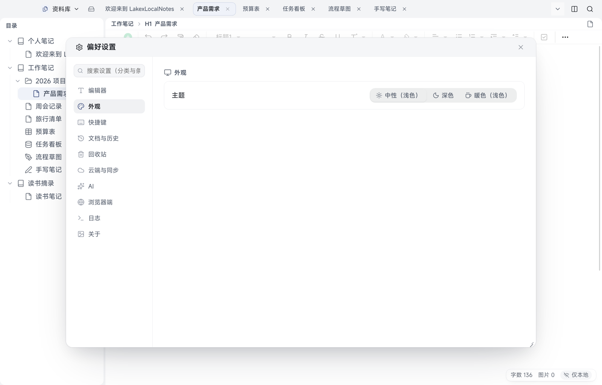
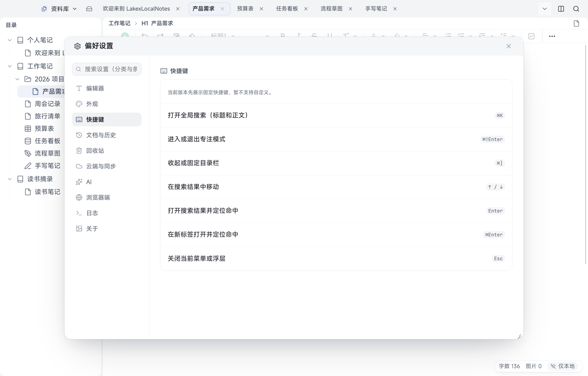
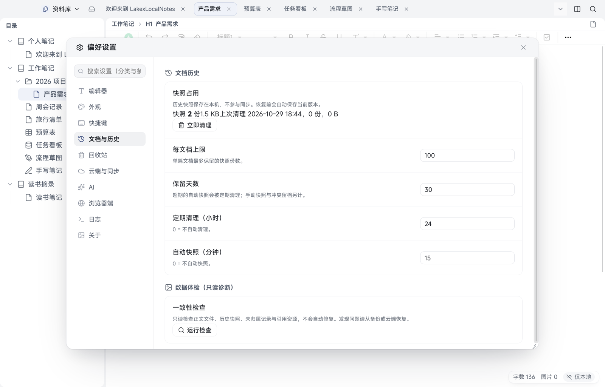
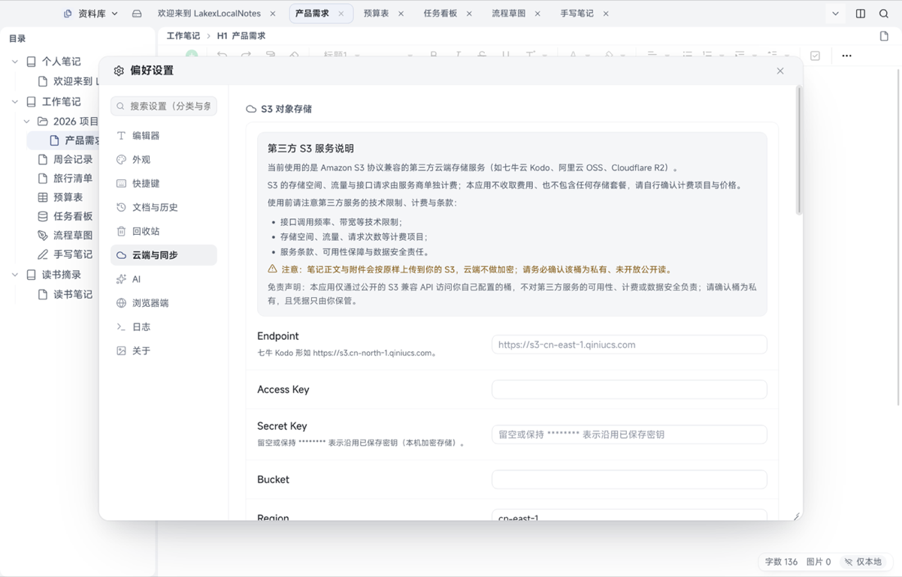
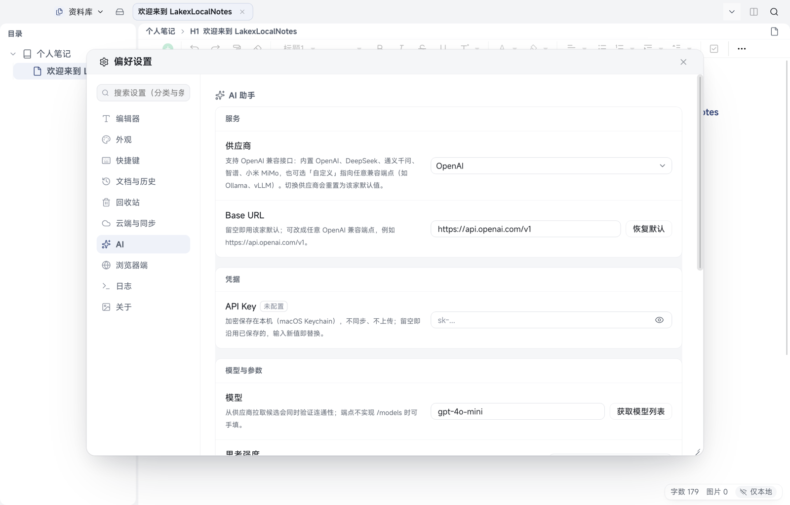
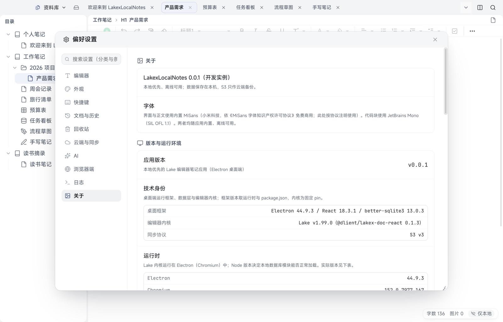
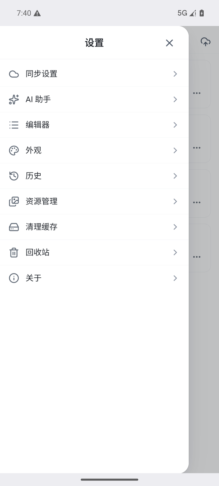
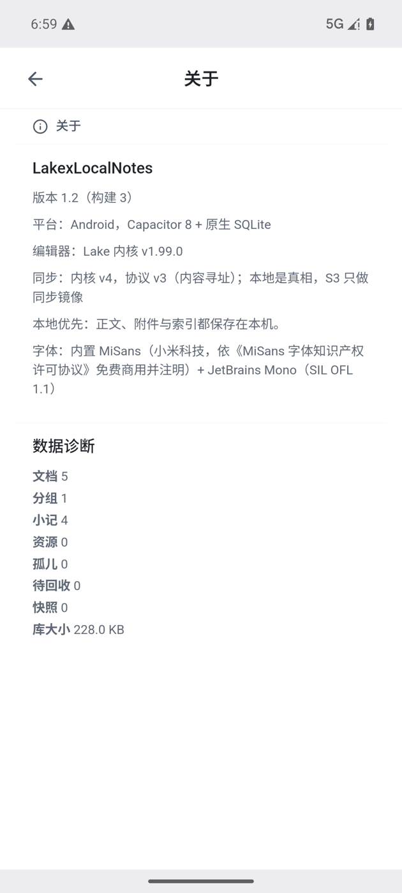
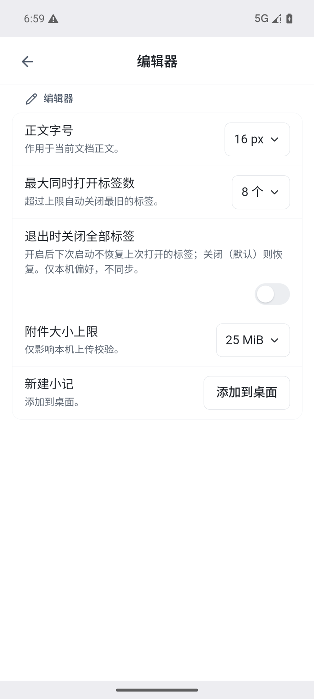

# 12 设置项逐条

[← 返回目录](README.md) | 上一章：[11 云同步](11-cloud-sync.md) | 下一章：[13 快捷键 →](13-shortcuts.md)

桌面：顶部「资料库」下拉 →「偏好设置」（也可从应用菜单打开）。左侧是分类导航，顺序为下面九项。

Android：首页左上角齿轮。根菜单顺序为同步设置、AI 助手、编辑器、外观、历史、资源管理、清理缓存、回收站、关于；面板右上角的「×」（关闭设置）可直接回到首页。

## 桌面设置

### 编辑器

| 设置项 | 说明 |
| --- | --- |
| 正文字号 | 只影响显示，不改文档内容，默认 16 px |
| 大纲增强 | 开启后右栏用增强大纲（可筛选、折叠、显示级别徽标）；关闭用原生大纲 |
| 显示固定工具栏 | 编辑器顶部固定工具栏，关闭后界面更简洁 |
| 浮动工具栏 | 选中文字或图片时在选区旁弹出格式工具条，与固定工具栏互不影响 |
| 最大同时打开标签数 | 超过上限自动关闭最旧的标签（当前编辑的标签与钉住的标签除外），未保存内容会自动保存，默认 8 个 |
| 退出时关闭全部标签 | 开启后下次启动不恢复上次打开的标签；默认关闭，只保存在本机 |

### 外观

主题三选一：中性（浅色）、深色、暖色（浅色）。主题只改变观感，不影响数据。

### 快捷键

当前版本先展示固定快捷键，**暂不支持自定义**。完整清单见 [13 快捷键](13-shortcuts.md)。

### 文档与历史

| 设置项 | 说明 |
| --- | --- |
| 快照占用 | 当前快照份数与占用空间、上次清理时间 |
| 立即清理 | 手动触发一次清理 |
| 每文档上限 | 单篇最多保留的快照份数 |
| 保留天数 | 超期自动快照会被定期清理（手动快照与冲突留档另计） |
| 定期清理（小时） | 0 = 不自动清理 |
| 自动快照（分钟） | 0 = 不自动快照 |
| 一致性检查 | 只读检查正文、快照、未归属记录与引用资源，不自动修复 |

### 回收站

| 设置项 | 说明 |
| --- | --- |
| 回收站自动过期（天） | 0 = 关闭。到期后自动彻底删除（含云端），不可撤销；需要保留请在到期前恢复 |

页面下方还会说明：回收站内容随云同步到所有设备；彻底删除会同时删除云端数据且不可撤销。

### 云端与同步

| 区块 | 内容 |
| --- | --- |
| S3 对象存储 | 第三方 S3 服务说明、计费与条款提示，Endpoint、Access Key、Secret Key、Bucket、Region、保存配置、测试连接 |
| 配置迁移 | 导出到文件…、从文件导入…、粘贴迁移码…（只含 S3 配置，导入会覆盖本机配置，文件含加密后的密钥） |
| 同步策略（仅保存在当前设备） | 启用云同步、「隐私数据（云端不加密）」提示 |
| 备份与恢复 | 整库备份到…、从云端恢复（换机） |

详见 [11 云同步](11-cloud-sync.md)。

### AI

供应商、Base URL、API Key、模型（获取模型列表）、温度、多轮对话说明、测试与开关（开关在「连通性」分组：配好密钥后可随时关闭，关闭后不出网）。详见 [10 AI 助手](10-ai.md)。

### 浏览器端

| 设置项 | 说明 |
| --- | --- |
| 启用浏览器端 | 在本机浏览器打开同一个本地库，只监听 `127.0.0.1:19880`，不向局域网开放 |

- 开关即时生效，但**不保存**：应用每次启动都从关闭开始
- 浏览器里读写的是本机同一份数据；同步进度与待办实时刷新
- 「另存为」走浏览器下载，附件在新标签打开；需要系统目录框的操作（导出、整库备份）仍在桌面端做

### 日志

| 区块 | 内容 |
| --- | --- |
| 全文搜索 | 重建全文搜索索引（平时自动维护，索引异常或换分词器后可手动重建） |
| 应用日志（只读） | 读取主进程日志，可按关键字过滤，每条命中带上下文 |

### 关于

显示应用版本、字体说明（MiSans 与 JetBrains Mono）、技术身份与运行时信息，用于反馈问题时提供版本线索。

## Android 设置

| 菜单 | 内容 |
| --- | --- |
| 同步设置 | S3 配置字段与配置迁移（从文件导入、粘贴迁移码、导出迁移码），详见 [11](11-cloud-sync.md) |
| AI 助手 | 接口地址、模型、API Key、温度、保存与测试连通性、开关、已保存对话（最多 50 条 30 天）、清空全部对话 |
| 编辑器 | 正文字号、最大同时打开标签数、退出时关闭全部标签、附件大小上限（默认 25 MiB）、把「新建小记」添加到桌面 |
| 外观 | 主题：浅色、深色 |
| 历史 | 历史快照相关设置与查看恢复 |
| 资源管理 | 文档里的图片与附件管理 |
| 清理缓存 | 清理本机缓存（不影响笔记内容） |
| 回收站 | 已删除的文档与小记，见 [09](09-history-trash.md) |
| 关于 | 版本、平台、字体说明与数据诊断（文档、分组、小记、资源、快照数量与库大小），可截图反馈问题 |

