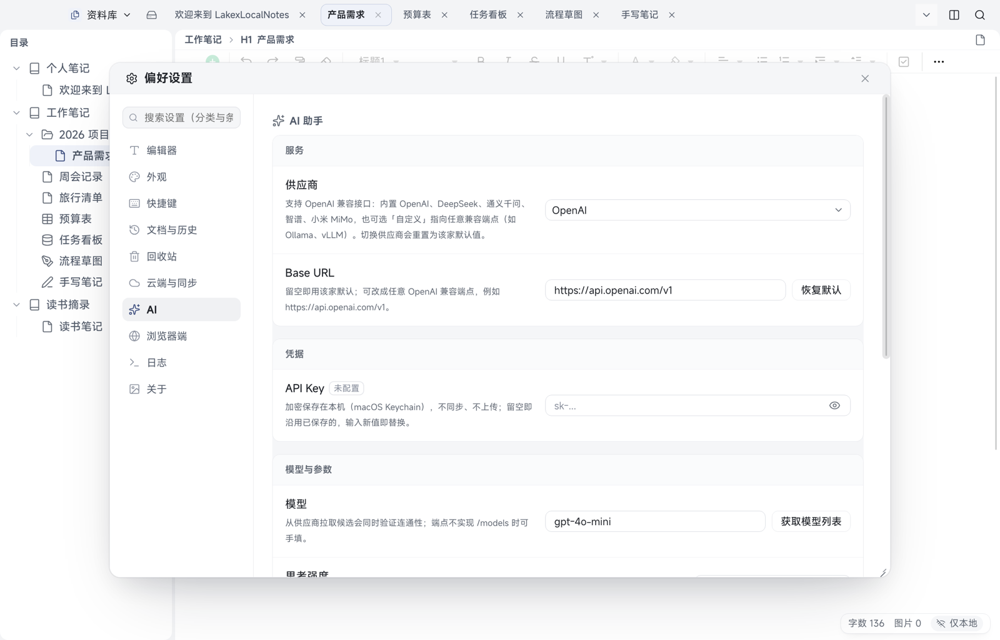

# 17 AI 写作

[← 返回目录](README.md) | 上一章：[16 日记](16-diary.md) | 下一章：[18 换机、便携包与迁移 →](18-portable-and-migrate.md)

AI 写作是**桌面专属**的长文对话空间：像和一个写作搭档反复讨论，答案按文档排版显示，满意了可以一键「生成文档」或「保存到小记」。桌面按 `⌘4` 进入。

> 别和 [10 AI 助手](10-ai.md) 混：AI 助手是在**文档里**改写、润色、提问的浮层；AI 写作是**独立空间**里的连续对话 + 长文产出。两者共用同一份供应商配置。

## 先配置

AI 写作依赖 AI 助手的那套配置：设置 → AI 助手里的供应商、Base URL、API Key、模型、思考强度。

- 没配置好时，空间里会直接给出引导，不会静默失败
- 「AI 助手」开关关闭时，空间显示「AI 助手已关闭」并提供「去开启」，不会向任何地址发请求
- 深度思考默认开启（沿用供应商配置里的思考强度），**空间内不提供关闭入口**

## 界面

- 进入 AI 写作会隐藏左侧目录栏，把宽度让给对话；左栏可拖动调宽（宽度只记在本机）
- **左栏**：标题、＋「新对话」、按今天/昨天/更早分组的「历史记录」行；顶部搜索框按标题过滤；行悬停出 `⋯`（重命名、置顶、删除）
- **主区空态**：模式切换（对话写作 / 多文档推理）、大标题、提示词库按钮、输入卡，以及「点一点试试」的两个示例
- **主区会话态**：消息流 + 固定在底部的输入卡

## 输入卡

| 控件 | 作用 |
| --- | --- |
| 提示词 | 打开提示词库（按主题的现成写法）；**点一行就把完整提示词写进输入框**，已有文字会换行追加、不覆盖 |
| 请选择文档 | 多文档推理时挑参考资料（见下） |
| 输入框 | `Enter` 发送、`Shift`+`Enter` 换行；生成中按钮变「停止」 |
| 发送 / 停止 | 停止只结束本次生成，已生成的部分保留 |

## 多文档推理

切到「多文档推理」后，「请选择文档」可以：

- 从**快捷组**里挑：今天 / 近一周 / 近一月的文档，或小记
- 或「按笔记本选择」：选一本笔记本，再勾它下面的文档

选中的是**当时的具体文档**（不是「某个笔记本里所有文档」），chip 上显示「已选 N 篇」。请求会带上这些文档的正文：单篇约 1.2 万字、合计约 4 万字、最多 20 篇，超出会截断并在界面上提示，不会静默丢内容。

## 读答案

- 答案按 Markdown 渲染（标题、列表、待办、表格、引用、代码、公式），用与文档相同的只读视图显示，不是纯文本框
- 助手消息上方有一行「已深度思考（用时 X 秒）」/「正在深度思考…」，**默认折叠**，点一下才展开思考内容，再点收起
- 操作条：重新生成、复制、生成文档、保存到小记
- 生成失败会写在**消息里**（带原因），可以重试；不会弹一堆对话框

## 生成文档 / 保存到小记

- **生成文档**：只让你选到**笔记本**（不选分组和目录），确认后把答案转成一篇文档放到那本笔记本里；标题可以在确认框里改
- **保存到小记**：打开一个弹层，先改正文再保存，落成一条小记卡片
- 两个弹层都是浮动窗（可拖、可缩放，位置与尺寸只记在本机）

## 会话存在哪

**只在本机**：

- 不进云同步、不进全文搜索、不进目录树，换机不会跟过去
- 桌面「整库备份」会带上它（备的是本机数据库）；**便携包不含 AI 会话**（便携包只搬笔记、小记、标签）
- 会话可以重命名、置顶（置顶只记在本机），删除后不可恢复
- 左栏只做「搜索 + 置顶」，不做对话分组

## 快捷键与相关章节

- 空间切换：`⌘4`（完整清单见 [13 快捷键](13-shortcuts.md)）
- 供应商与密钥口径（Key 只在主进程、不写正文、不进备份）见 [10 AI 助手](10-ai.md)
- 换机要带走笔记与小记，见 [18 换机、便携包与迁移](18-portable-and-migrate.md)

## 没有做什么

- Android 不提供 AI 写作（手机端是[第 10 章的 AI 助手](10-ai.md)）
- 不做会话跨端同步、不做服务端续写：停止即终态，想接着写就重新生成
- 不做多窗口并排对话；需要对照时用桌面分屏看两篇文档
