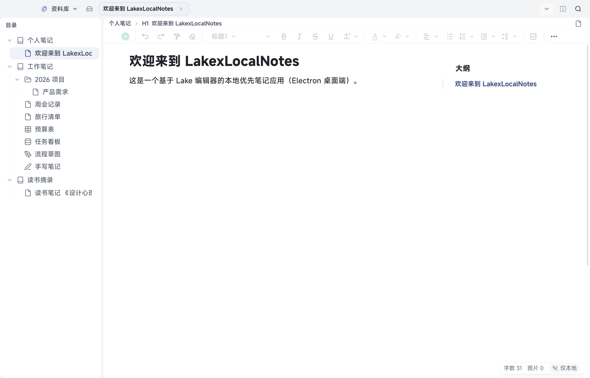

# LakexLocalNotes 使用说明

LakexLocalNotes 是一款**本地优先**的笔记应用：笔记、表格、多维表、画板、手写板、日记和小记都保存在你自己的电脑或手机上，不需要注册账号，也不依赖任何云端服务。

- 数据默认只在本机（桌面见 [数据在哪里](#data-location)）
- 想要多设备同步时，可以接自己的对象存储（例如七牛云、阿里云 OSS、Cloudflare R2），见 [11 云同步](11-cloud-sync.md)
- 桌面端为 macOS 应用，移动端为 Android 应用；桌面还可以在本机浏览器里打开同一份数据（设置 → 浏览器端，默认关）
- **五个一级空间**（两端同名）：知识库、小记、[日记](16-diary.md)、[AI 写作](17-ai-writing.md)（桌面）、标签；桌面用 `⌘1`–`⌘5` 直接切换

> 本手册只写当前版本里真实存在的功能。界面以你安装的版本为准，个别文案可能微调。

## 5 分钟上手

1. **安装**：桌面端用发布页的 `.dmg`（首次打开需右键选择「打开」）；Android 用发布的 `.apk`。
2. **打开就有一个笔记本**：首次启动会自动创建「个人笔记」和一篇欢迎文档，直接在里面写就行。
3. **新建文档**：桌面点左上角空间菜单「知识库」，或目录栏的「新建」；Android 在首页底部 Dock 中间的「＋」。
4. **写**：正文即点即写，工具栏改标题、加粗、列表、待办等。
5. **找**：桌面按 `⌘K` 全局搜索；Android 点首页顶栏右侧的放大镜。
6. **删错了别慌**：删除的文档先进回收站，默认 90 天后才自动清理，见 [09 历史快照与回收站](09-history-trash.md)。

## 目录

| 章节 | 内容 |
| --- | --- |
| [01 开始使用与界面总览](01-getting-started.md) | 桌面与 Android 的界面分区，每个区域管什么 |
| [02 笔记本与目录](02-notebooks.md) | 新建笔记本、分组、重命名、移动、图标、删除与恢复 |
| [03 文档编辑](03-editing.md) | 标题、列表、待办、引用、代码块、图片、附件、文档引用等 |
| [04 表格](04-sheet.md) | 电子表格的工具栏、公式、数字格式、冻结、筛选 |
| [05 多维表](05-bitable.md) | 字段类型、表格视图、看板、筛选排序、记录详情 |
| [06 画板与手写板](06-board-ink.md) | 两种手写/绘图文档怎么用；手写板插入图片/PDF、批注、导出 PDF |
| [07 小记](07-quick-notes.md) | 随手记的入口、标签、转正式文档、保存与保存并同步 |
| [08 搜索、大纲与标签](08-search-outline-tags.md) | 全局搜索、文档内查找、大纲、小记标签 |
| [09 历史快照与回收站](09-history-trash.md) | 恢复历史版本、回收站、云端已删除（仅本地） |
| [10 AI 助手](10-ai.md) | 配置供应商、测试连通性、三个入口、资料集 |
| [11 云同步](11-cloud-sync.md) | S3 配置、测试连接、迁移码、启用开关、从云端恢复、**多端同步的正确表现**（回收站 / 移动 / 编辑锁 / 冲突） |
| [12 设置项逐条](12-settings.md) | 桌面与 Android 的每一个设置项 |
| [13 快捷键](13-shortcuts.md) | 当前版本的固定快捷键 |
| [14 常见问题](14-faq.md) | 同步失败、**跳过项排查**、**文档变只读的原因**、冲突、缺正文、换机、数据目录 |
| [15 导入、批量操作与导出](15-import-export.md) | 导入 Markdown / Word / Excel / CSV（桌面；Android 收系统分享的 md）、多选批量操作、批量导出默认格式 |
| [16 日记](16-diary.md) | 写今天、一天多篇、年月分组、转文档、不做标签与缺天提醒 |
| [17 AI 写作](17-ai-writing.md) | 桌面独立写作空间：会话、多文档推理、生成文档、会话只在本机 |
| [18 换机、便携包与迁移](18-portable-and-migrate.md) | 便携包（离线全量）、S3 同步（增量）、迁移码（只搬配置）三条路怎么选 |
| [19 更新中心](19-update-center.md) | 检查更新、更新日志、自动检查与自动下载、为什么不会静默安装 |

## 两个平台有什么不同

| 能力 | 桌面（macOS） | Android |
| --- | --- | --- |
| 界面结构 | 顶栏空间菜单 + 目录栏 + 标签页 + 编辑区 + 右栏大纲 | 首页（底部五格 Dock + 中央悬浮「＋」）+ 工作区（工作区胶囊）+ 编辑态底部工具条 |
| 一级空间 | 知识库 / 小记 / 日记 / AI 写作 / 标签（`⌘1`–`⌘5`） | 首页底部五格 Dock 同序：小记 / 知识库 / 日记 / AI / 标签（左右滑动切页） |
| 顶部工具栏 | 编辑器固定工具栏常驻，可关 | 无固定工具栏，格式在编辑态底部工具条 |
| 多标签 | 支持，可同时开多篇（文档与日记分开计数） | 单文档工作区 |
| 大纲 | 右栏常驻，可切增强大纲 | 工作区胶囊「大纲」抽屉 |
| 文档内查找 | `⌘F` 查找面板 | 工作区顶栏放大镜，自带查找条 |
| 小记 | 空间菜单 → 小记（`⌘2`） | 首页 Dock 第 1 格「小记」；长按中央「＋」上滑可直接速记 |
| 日记 | 独立空间（`⌘3`），左栏年月时间线可拖宽 | 首页 Dock 第 3 格，同一套写今天/按日期新建，无左栏 |
| AI 写作 | 独立空间（`⌘4`），会话、多文档推理、生成文档 | 不提供（手机端是 AI 助手，见第 4 格） |
| 表格/多维表/画板 | 完整编辑 | 查看为主，表格有移动版工具条 |
| 手写板 | 支持（鼠标/手写笔） | 支持（触屏） |
| 云同步配置 | 设置 → 云端与同步 | 设置 → 云端与同步 |
| 导入文件 | ＋ → 导入 → Markdown / Word / Excel / CSV（可多选） | 系统分享 .md → 默认笔记本（首次分享时选择） |
| 导出 | 单篇导出、批量导出（按类型默认格式）、整库备份 | 无系统目录框，导出请在桌面端做 |
| 更新中心 | 设置 → 更新 | 设置 → 更新中心 |
| 便携包 | 导出 `.zip.lln`（≤4GiB，不含历史快照） | 从便携包导入（覆盖本机） |
| 批量操作 | ⌘/Ctrl + Shift 多选，右键 移动/导出/移入回收站 | 长按或页头「选择」进入多选，移动/打标签/移入回收站 |
| 浏览器端 | 设置 → 浏览器端（默认关） | 不提供 |

### 两种「胶囊」，别弄混

- **首页底部五格 Dock + 中央悬浮「＋」**：Android 首页切换一级空间（小记/知识库/日记/AI/标签），中间的「＋」管新建（短按 = 新建面板，长按 260ms 后上滑 = 直接进速记写作卡）
- **工作区胶囊**：进入文档后的底部小条，四格是 **文档树、标签页、大纲、切换笔记本**；平板与手机同一套，平板只是更宽、树与大纲默认悬浮且可固定

## 数据在哪里

- 桌面：`~/Library/Application Support/lakex-local-notes/`（开发版为 `lakex-local-notes-dev/`），菜单「帮助 → 打开数据目录」可直接定位
- Android：应用私有目录，卸载应用会连同数据一起删除
- 备份：桌面「设置 → 备份与恢复 → 整库备份到…」导出数据库、全部笔记、资源与历史快照；自动备份（仅数据库）默认每天一份，保留最近若干份
- 换到手机：桌面「设置 → 备份与恢复 → 导出便携包」得到一个 `.zip.lln`，手机「从便携包导入（覆盖本机）」；没配 S3 也能用，之后接上 S3 只做增量 —— 详见 [18 换机、便携包与迁移](18-portable-and-migrate.md)

## 关于本手册

- 截图来自当前版本的桌面端与 Android 端实机
- 手册与程序一样，欢迎随版本一起更新；发现与界面不一致的地方，以界面为准
